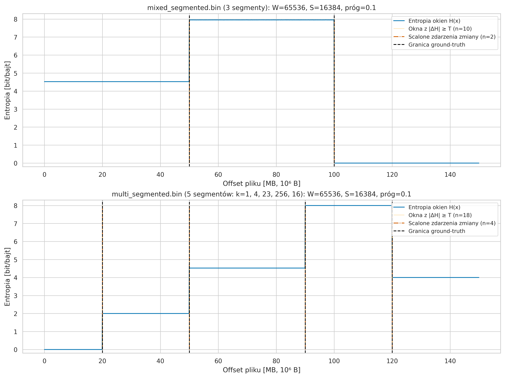
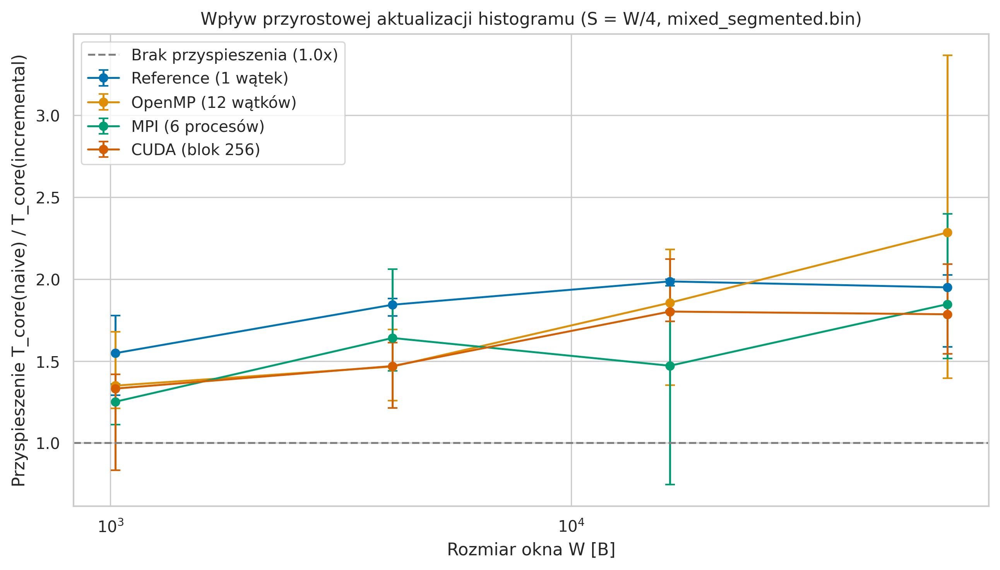
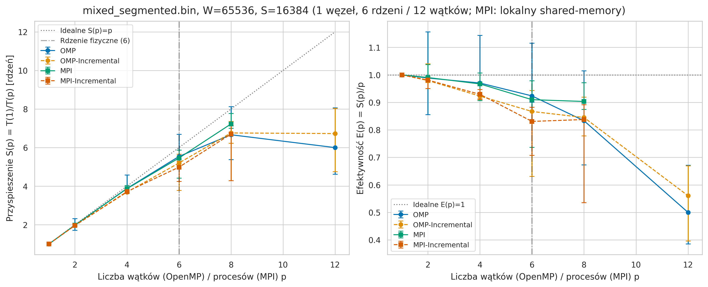
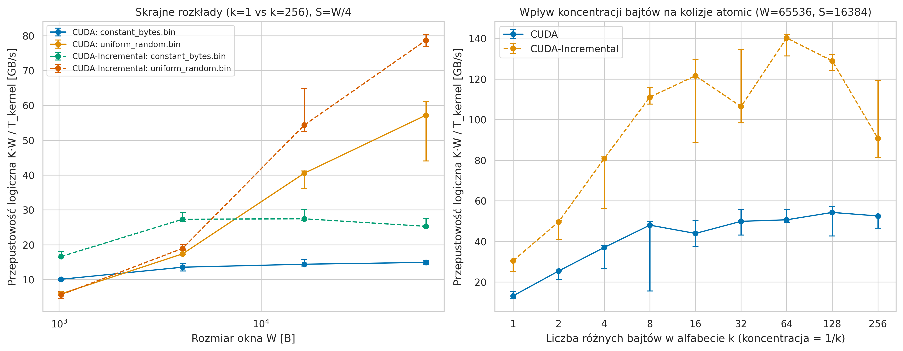
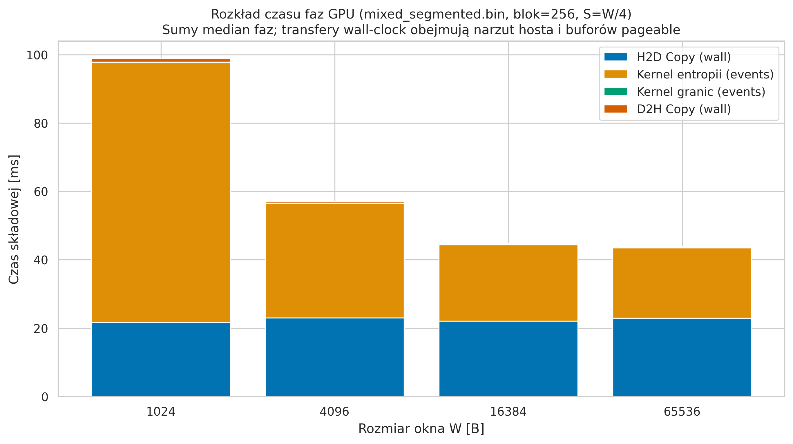
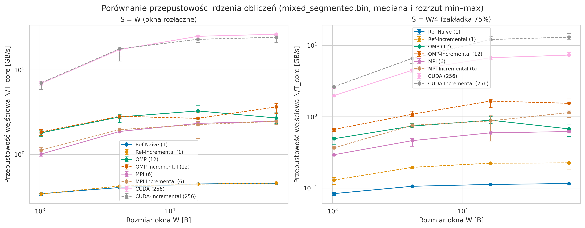

# Od Zera do Superkomputera: Przewodnik po Projekcie „C05 – Entropia i segmentacja plików binarnych”

> **Dla kogo jest ten przewodnik?**
> Wyobraź sobie, że siedzimy przy kawie, a Ty mówisz: *„Słuchaj, zupełnie nie znam się na programowaniu, procesorach ani kartach graficznych, ale chcę naprawdę zrozumieć, o co chodzi w Waszym projekcie akademickim – od pierwszej zasady aż po architekturę kodu i wyniki pomiarów”*.
> Ten dokument powstał właśnie dla Ciebie. Zaczniemy od pudełka z klockami LEGO, a skończymy na tysiącach równoległych wątków karty graficznej NVIDIA i architekturze współczesnych systemów wysokowydajnych (HPC – *High-Performance Computing*).

---

## 1. Wprowadzenie: Czym w ogóle jest ten problem? (Wyjaśnienie dla 10-latka)

Zanim dotkniemy jakiegokolwiek komputera, musimy odpowiedzieć na trzy proste pytania: **czym jest plik binarny**, **czym jest tajemniczo brzmiąca entropia Shannona** i **dlaczego detektywi komputerowi tak bardzo ją lubią**.

### 1.1. Co to jest plik binarny? (Sekretne życie każdego pliku)

Kiedy patrzysz na ekran komputera, widzisz różne rzeczy: dokument tekstowy z wypracowaniem, zdjęcie z wakacji, piosenkę w formacie MP3 albo grę komputerową. Dla Twoich oczu to zupełnie różne światy.

Ale zdradzę Ci sekret: **dla komputera one wszystkie wyglądają dokładnie tak samo**.

Komputer wewnątrz swojej pamięci nie przechowuje ani obrazków, ani liter, ani dźwięków. Komputer zna tylko przełączniki, które mogą być:
* **wyłączone (`0`)** albo
* **włączone (`1`)**.

Taką pojedynczą cyferkę (`0` lub `1`) nazywamy **bitem**. Ponieważ jeden bit to trochę za mało, żeby zapisać choćby jedną literę alfabetu, informatycy umówili się, że będą pakować bity w małe paczuszki po **8 sztuk**. Taka ośmiobitowa paczuszka nazywa się **bajtem** (ang. *byte*).

Ile różnych kombinacji zer i jedynek można ułożyć z 8 bitów? Dokładnie **256** – co odpowiada zwykłym liczbom od **0 do 255**.
* W pliku tekstowym liczba `65` oznacza wielką literę **`A`**, liczba `66` to **`B`**, a liczba `32` to **spacja**.
* W zdjęciu te same liczby od `0` do `255` mogą oznaczać, jak bardzo jasny jest dany punkt na ekranie.
* W programie komputerowym te same liczby oznaczają rozkazy dla procesora.

> **Definicja bez żargonu:**
> **Plik binarny** to po prostu każdy plik w komputerze widziany „nago” – jako długi sznurek koralików (bajtów), gdzie każdy koralik ma wybity numer od **0 do 255**. Plik o rozmiarze 16 megabajtów (16 MB) to po prostu sznurek złożony z prawie **17 milionów takich koralików** ułożonych jeden za drugim!

---

### 1.2. Co to jest Entropia Shannona? (Zabawa w pudełka z klockami LEGO)

Słowo **„entropia”** brzmi groźnie – jak coś, czym straszą fizycy na uniwersytecie. W rzeczywistości w informatyce, dzięki genialnemu matematykowi **Claude’owi Shannonowi** (ojcu tzw. teorii informacji z 1948 roku), entropia oznacza coś bardzo intuicyjnego: **miarę zaskoczenia, różnorodności lub nieporządku**.

Wyobraź sobie, że masz przed sobą **trzy nieprzezroczyste pudełka z klockami LEGO**. W każdym pudełku jest po tysiąc klocków, a w fabryce LEGO produkuje się dokładnie **256 kolorów** klocków (zupełnie jak nasze 256 możliwych wartości bajtu od 0 do 255!). Zamykasz oczy i losujesz jeden klocek z pudełka.

* **Pudełko nr 1: Idealna nuda (Entropia = 0 bitów)**
  W tym pudełku wszystkie 1000 klocków są **czerwone**. Zamykasz oczy, wkładasz rękę i wyciągasz klocek. Jaki ma kolor? Czerwony. Wyciągasz drugi – czerwony. Trzeci – czerwony.
  Jak bardzo jesteś zaskoczony wynikiem losowania? **Zero zaskoczenia!** Zanim włożyłeś rękę do pudełka, już wiedziałeś, co wyciągniesz. W języku Shannona mówimy: **entropia tego pudełka wynosi 0,00 bitów na klocek**. W świecie plików komputerowych tak wygląda np. pusty obszar dysku wypełniony samymi zerami (`constant_bytes.bin`).

* **Pudełko nr 2: Książka po polsku lub angielsku (Entropia średnia, ok. 4,5 – 5,0 bitów)**
  W drugim pudełku kolory klocków odpowiadają literom ze zwykłej książki. Nie wszystkie 256 kolorów występują tu po równo! Używamy głównie około 30–40 kolorów (małe i wielkie litery, spacje, kropki, przecinki). Co więcej, niektóre kolory – jak spacja czy samogłoski `a`, `e`, `i`, `o` – trafiają się bardzo często, a inne – jak `ź` czy `q` – rzadko.
  Gdy losujesz klocek z zamkniętymi oczami, masz pewną niespodziankę, ale całkiem nieźle potrafisz zgadywać, że to będzie któraś z popularnych liter. **Entropia takiego pudełka wynosi około 4,5 do 5,0 bitów**.

* **Pudełko nr 3: Totalny chaos (Entropia maksymalna = 8,00 bitów)**
  W trzecim pudełku ktoś wsypał wszystkie **256 kolorów** dokładnie po równo i wymieszał je mikserem. Kiedy wkładasz rękę z zamkniętymi oczami, nie masz absolutnie żadnego pojęcia, jaki kolor wyciągniesz. Każdy z 256 kolorów jest tak samo prawdopodobny!
  Twoje zaskoczenie jest maksymalne. Ponieważ aby jednoznacznie wskazać jeden z 256 kolorów, musisz zadać dokładnie 8 pytań „tak/nie” ($2^8 = 256$), **maksymalna entropia Shannona dla bajtów wynosi dokładnie 8,00 bitów**.

> **Zapamiętaj prostą skalę entropii dla plików (od 0 do 8):**
> * **`0.0` bitów** $\rightarrow$ całkowita monotonia (jeden powtarzający się znak w kółko).
> * **`4.0 – 5.5` bitów** $\rightarrow$ uporządkowane dane ludzkie (zwykły tekst, kod źródłowy, proste tabele).
> * **`7.9 – 8.0` bitów** $\rightarrow$ maksymalny pozorny chaos (dane silnie skompresowane, np. ZIP/JPG, dane całkowicie losowe albo zaszyfrowane).

---

### 1.3. Po co nam to? (Rentgen detektywa komputerowego)

Skoro już wiemy, czym jest entropia, pojawia się pytanie: **po co komputer ma liczyć entropię w różnych miejscach pliku?**

Wyobraź sobie, że jesteś celnikiem na granicy, a przed Tobą jedzie długi pociąg towarowy złożony z tysiąca zamkniętych wagonów. Nie masz kluczy do wagonów albo nie wiesz, w jakim języku napisano listy przewozowe. Chciałbyś jednak błyskawicznie – bez otwierania każdego pudełka i bez uruchamiania potencjalnie niebezpiecznego programu – prześwietlić ten pociąg **rentgenem strukturalnym**.

Właśnie tym zajmuje się **segmentacja plików binarnych za pomocą entropii**:
1. **Wykrywanie ukrytych ładunków (Cyberbezpieczeństwo / Malware Analysis):**
   Wyobraź sobie niewinnie wyglądający dokument albo program instalacyjny. Przez pierwsze trzy czwarte pliku ciągnie się zwykły tekst i standardowe instrukcje programu – wykres entropii spokojnie faluje w okolicach **0,0 – 4,8 bita**. Nagle, w połowie pliku, wykres entropii wystrzeliwuje pionowo w górę do **7,99 bita**!
   Co to oznacza? Ktoś „dokleił” w tym miejscu **zaszyfrowany lub spakowany ładunek** (np. ukrytego wirusa, który sam się odszyfrowuje dopiero po uruchomieniu). Nasz program wykrywa taki **skok entropii** (przekraczający zadany próg, np. $\Delta H > 1{,}5$ bita) i mówi: *„Uwaga! Dokładnie na bajcie nr 8 388 608 kończy się jedna kraina, a zaczyna zupełnie inna!”*.
2. **Odzyskiwanie danych i analiza nieznanych plików (Forensics):**
   Gdy na uszkodzonym dysku twardym zniknie spis treści (tablica partycji), dysk staje się jednym gigantycznym ciągiem miliardów bajtów. Przesuwając miernik entropii wzdłuż dysku, możemy znaleźć granice między pustym miejscem (entropia `0`), plikami tekstowymi (entropia `~4,7`) a archiwami ZIP lub zdjęciami (entropia `~7,98`).

> **Ważna przestroga naukowa (z karty projektu C05):**
> Czy wysoka entropia (~8,0 bitów) zawsze oznacza wirusa albo szyfrowanie? **Absolutnie nie!**
> Dobrze spakowane archiwum `.zip` albo zdjęcie z wakacji `.jpg` też mają entropię bliską 8 bitów (bo program pakujący usunął z nich wszystkie powtórzenia). Entropia nie jest więc wyrocznią mówiącą *„to na pewno wirus”*, lecz **niezwykle szybkim radarem wskazującym granice obszarów o różnej budowie**.



---

## 2. Jak to policzyć krok po kroku? (Okno przesuwne i histogram)

Gdybyśmy policzyli jedną wspólną entropię dla całego dużego pliku – na przykład takiego, który w pierwszej połowie zawiera same zera, a w drugiej dane losowe – dostalibyśmy jedną uśrednioną liczbę i **nie wiedzielibyśmy, w którym miejscu plik zmienia swój charakter**. Dlatego potrzebujemy metody, która bada plik kawałek po kawałku.

### 2.1. Pojęcie „okna przesuwnego” (Sliding Window) – Lupa nad książką

Wyobraź sobie, że kładziesz na stole bardzo długi zwój pergaminu zapisany milionami znaków, a do ręki bierzesz **prostokątną ramkę (lupę)**:
1. **Rozmiar okna (`window_size`, oznaczany jako $W$):**
   Nasza ramka ma stałą szerokość – w naszym projekcie domyślnie obejmuje dokładnie **$W = 4096$ kolejnych bajtów** (czyli 4 kilobajty tekstu naraz).
2. **Krok okna (`step_size`, oznaczany jako $S$):**
   Kładziemy ramkę na samym początku zwoju (od pozycji `0` do `4096`), badamy to, co widać w środku, i zapisujemy wynik. Następnie przesuwamy ramkę w prawo o stały krok **$S$** (np. o $S = 1024$ bajty albo o $S = 64$ bajty) i znów badamy to, co znajduje się pod lupą!
3. **Co zrobić na samym końcu zwoju? (Polityka końca pliku):**
   Załóżmy, że dochodzimy do końca książki i zostało nam już tylko 500 znaków, a nasza ramka ma szerokość 4096. W projekcie przewidzieliśmy dwie jasne reguły:
   * **`drop` (pomiń końcówkę – domyślna):** oceniamy tylko pełne ramki o długości 4096 bajtów, a niepełny ogonek na końcu pomijamy, żeby nie zafałszować statystyki.
   * **`pad` (dopełnij zerami):** jeśli badacz koniecznie chce objąć końcówkę, brakujące miejsce w ramce uzupełniamy sztucznymi zerami.

---

### 2.2. Jak działa zliczanie znaków? (Histogram z 256 koszykami)

Co dokładnie robimy, kiedy lupa zatrzyma się nad kolejnym fragmentem o długości 4096 bajtów?

Stawiamy przed sobą rząd **256 małych koszyków** (ponumerowanych od `0` do `255`). Na początku wszystkie koszyki są puste.
* Patrzymy na pierwszy bajt pod lupą: ma wartość `65` $\rightarrow$ wrzucamy kamyk do koszyka nr `65`.
* Drugi bajt ma wartość `0` $\rightarrow$ wrzucamy kamyk do koszyka nr `0`.
* Trzeci bajt znów ma wartość `65` $\rightarrow$ dorzucamy drugi kamyk do koszyka nr `65`.

Po przejrzeniu wszystkich 4096 bajtów pod lupą mamy gotowe zestawienie, ile kamyków wpadło do każdego z 256 koszyków. W statystyce i informatyce takie zestawienie nazywa się **histogramem**.

Następnie dla każdego koszyka, w którym jest **przynajmniej jeden kamyk** (puste koszyki z zerową liczbą kamyków całkowicie pomijamy!), dzielimy liczbę kamyków przez rozmiar okna (4096), otrzymując ułamek $p_i$ (prawdopodobieństwo), i podstawiamy do wzoru Shannona:

$$H = -\sum_{i=0, \, c_i > 0}^{255} p_i \log_2(p_i)$$

Z tego wzoru wyskakuje jedna liczba od `0.00` do `8.00` – entropia badanego okna!

---

### 2.3. Kluczowy problem optymalizacyjny: Podejście „Naiwne” kontra „Przyrostowe” (Incremental)

Tutaj dochodzimy do jednego z najpiękniejszych pomysłów w całym projekcie (stanowiącego rozszerzenie dla zespołu dwuosobowego!).

Wyobraź sobie, że Twoja lupa obejmuje **4096 słów**, a Ty przesuwasz ją bardzo gęsto – za każdym razem tylko o **64 słowa w prawo** ($W = 4096, S = 64$), żeby niezwykle precyzyjnie namierzyć granicę w pliku.

Zauważ, co się dzieje przy takim przesunięciu:
Nowe okno i stare okno mają aż **4032 wspólne słowa**! Tylko 64 słowa wypadły z lewej strony lupy i tylko 64 nowe słowa weszły z prawej strony.

Mamy teraz dwa sposoby pracy:

#### Sposób 1: Podejście Naiwne (`--mode naive`) – Syzyfowa praca
Za każdym razem, gdy przesuniesz lupę o 64 słowa w prawo:
1. **Wysypujesz wszystkie kamyki** ze wszystkich 256 koszyków na podłogę.
2. Zaczynasz czytać całe okno (wszystkie **4096 słów**) od samego początku!

To znaczy, że te same 4032 słowa, które przed chwilą policzyłeś, liczysz od nowa! I za chwilę znów od nowa! Przy kroku $S = 64$ każdy bajt pliku jest czytany przez komputer aż **64 razy** ($4096 / 64 = 64$).

#### Sposób 2: Podejście Przyrostowe (`--mode incremental`) – Sprytny księgowy
A gdybyśmy nie wysypywali kamyków z koszyków?
Skoro przesuwamy lupę o 64 znaki w prawo, to zawartość naszych 256 koszyków prawie się nie zmieniła! Wystarczy zrobić dwie szybkie rzeczy:
1. Spojrzeć na **64 znaki, które właśnie zniknęły z lewej strony spod lupy**, i **wyjąć (odjąć)** odpowiadające im kamyki z koszyków.
2. Spojrzeć na **64 nowe znaki, które właśnie pojawiły się z prawej strony pod lupą**, i **dorzucić (dodać)** ich kamyki do koszyków.

```
Okno poprzednie (k):    [ Stary_L (64B) |       Wspólny środek (4032B)       ]
Okno kolejne (k+1):                     [       Wspólny środek (4032B)       | Nowy_P (64B) ]
                                         \__________________________________/
                                          Tego fragmentu NIE LICZYMY od nowa!
                                          Histogram_nowy = Histogram_stary - Stary_L + Nowy_P
```

* **Ile operacji wykonuje podejście naiwne?** `4096` operacji na okno.
* **Ile operacji wykonuje podejście przyrostowe?** `64` odjęcia + `64` dodawania = **`128` operacji na okno** (czyli **32 razy mniej pracy** przy aktualizacji koszyków!).
* **Jaki dało to efekt w naszych pomiarach?** Na pojedynczym rdzeniu procesora przy kroku $S = 64$ prędkość przetwarzania wzrosła z **0,53 GB/s** (tryb naiwny) do **8,85 GB/s** (tryb przyrostowy) – to niemal **17-krotne przyspieszenie** uzyskiwane samym sprytem matematycznym, zanim jeszcze włączyliśmy jakiekolwiek zrównoleglenie!

> **Ciekawostka dla dociekliwych:**
> A co się stanie, jeśli krok przesunięcia lupy $S$ jest bardzo duży – na przykład większy niż połowa okna ($S \ge W/2$, powiedzmy $W = 4096$, a $S = 3000$)? Wtedy odjęcie 3000 starych kamyków i dodanie 3000 nowych wymagałoby 6000 ruchów, czyli więcej niż policzenie 4096 kamyków od zera! Dlatego nasz program jest inteligentny: sam sprawdza warunek `if (step < window)` i gdy okna mocno na siebie zachodzą, używa trybu przyrostowego, a gdy nie zachodzą – automatycznie przełącza się na liczenie bezpośrednie.



---

## 3. Potrzeba szybkości: Jak zrównoleglić pracę? (Trzy poziomy wtajemniczenia)

Skoro jeden pracownik (jeden rdzeń procesora) radzi sobie tak dobrze, to jak przyspieszyć pracę jeszcze bardziej, gdy mamy do przeanalizowania gigabajty albo terabajty danych? Odpowiedź brzmi: **zatrudnić więcej pracowników naraz (przetwarzanie równoległe)**.

W naszym projekcie zaimplementowaliśmy i porównaliśmy **trzy fundamentalne technologie współczesnego superkomputingu**: **OpenMP**, **MPI** oraz **CUDA**. Wyjaśnijmy je na przykładzie fabryki analizującej wielką księgę.

---

### 3.1. Poziom 1: OpenMP (Wielowątkowość procesora CPU) – Pracownicy w jednym pokoju

Wyobraź sobie duży pokój biurowy. Na środku stoi jeden wielki stół, a na nim leży otwarta księga (to nasza wspólna pamięć operacyjna **RAM**). Wokół stołu siedzi **kilku niezwykle bystrych pracowników** – to rdzenie naszego procesora (w użytym przez nas procesorze **AMD Ryzen 5 2600** mamy **6 fizycznych rdzeni**, które dzięki technologii wielowątkowości SMT pracują jak **12 pracowników**).

Ponieważ wszyscy siedzą w tym samym pokoju przy jednym stole, każdy pracownik widzi całą księgę od razu. Nie trzeba robić kserokopii ani wysyłać listów pocztą. Dzielimy po prostu listę okien do policzenia między pracowników: *„Ty liczysz okna od 1 do 1000, Ty od 1001 do 2000...”*.

#### Pułapka: Kłótnia o ten sam ołówek (*Race Condition* oraz *False Sharing*)
Co by się stało, gdyby wszyscy 12 pracowników używało **jednego wspólnego zestawu 256 koszyków** stojącego na środku stołu (albo zapisywało swoje robocze obliczenia na tej samej kartce papieru leżącej na stole)?
1. **Wyścig o koszyk (*Data Race*):** Gdy dwóch pracowników jednocześnie wyciąga rękę, by wrzucić kamyk do koszyka nr `0`, zderzają się łokciami i jeden kamyk ginie lub zostaje źle policzony.
2. **Fałszywe współdzielenie (*False Sharing*):** Nawet gdyby każdy pracownik miał swoją kolumnę na jednej wspólnej kartce papieru, to w świecie procesorów pamięć podręczna (tzw. *Cache*) działa tak, że pracownik, który chce coś dopisać, musi zabrać całą kartkę (tzw. linię cache o szerokości 64 bajtów) dla siebie! Pozostałych 11 pracowników stoi wtedy z założonymi rękami i czeka: *„Oddaj kartkę, teraz ja piszę!”*. Praca staje w miejscu.

#### Nasze rozwiązanie w projekcie: Prywatny brudnopis dla każdego!
W naszym kodzie OpenMP (`src/openmp.cpp`) rozwiązaliśmy ten problem u samego źródła:
* **Każdy wątek (pracownik) dostaje swój własny, prywatny zestaw 256 koszyków** (`std::array<uint32_t, 256> counts`), trzymany wyłącznie w jego własnych rękach (na jego prywatnym stosie pamięci). Zero wyrywania sobie kartek!
* Co więcej, w trybie przyrostowym (`incremental`) użyliśmy statycznego przydziału ciągłych rozdziałów księgi (`#pragma omp for schedule(static)`). Każdy z 12 pracowników dostaje swój własny spójny rozdział, tylko **pierwsze okno swojego rozdziału liczy od zera**, a wszystkie kolejne tysiące okien w swoim rozdziale przelicza błyskawicznie metodą przyrostową!
* Dopiero gotową jedną liczbę (policzoną entropię okna nr `i`) pracownik wpisuje na swoje wyznaczone miejsce w tabeli końcowej.

---

### 3.2. Poziom 2: MPI (Przetwarzanie rozproszone) – Oddzielne fabryki i telefony

Metoda OpenMP (wspólny pokój) ma jedno ograniczenie: do jednego pokoju (jednej płyty głównej komputera) nie zmieścisz tysiąca pracowników. Jeśli chcesz użyć **100 oddzielnych komputerów** połączonych w superkomputer (klaster), musisz wyjść poza jeden budynek.

Do tego służy **MPI (*Message Passing Interface*)**.
Wyobraź sobie, że zamiast jednego pokoju mamy **kilka oddzielnych budynków (fabryk)** rozrzuconych po mieście. W każdym budynku siedzi osobny pracownik (proces MPI).
* Pracownik w Budynku nr 2 **nie widzi** stołu w Budynku nr 1! Każdy budynek ma wyłącznie własne biurko i własną pamięć.
* Jedynym sposobem współpracy jest **wysyłanie paczek kurierem lub dzwonienie przez telefon** (komunikaty sieciowe `MPI_Send`, `MPI_Recv`, `MPI_Gatherv`).

#### Kluczowy problem w MPI: Problem „Zakładki” (*Halo / Overlap*)
Załóżmy, że księga ma 100 stron, a my mamy 2 budynki. Dyrektor (Budynek nr 0 – *Master*) przecina księgę nożyczkami na pół:
* Budynek nr 0 zostawia sobie strony `1–50`.
* Budynek nr 1 dostaje pocztą strony `51–100`.

I nagle pojawia się problem! Co z oknem (lupą), które zaczyna się pod koniec strony `50`, a kończy na początku strony `51`?!
* Pracownik w Budynku nr 0 nie może go policzyć, bo brakuje mu początku strony `51` (która pojechała do Budynku nr 1).
* Pracownik w Budynku nr 1 też nie może go policzyć, bo nie ma końcówki strony `50`!
Gdybyśmy o to nie zadbali, **zgubilibyśmy słowa leżące na granicy podziału** (albo policzyli je podwójnie).

```
Cały plik:       [================ Część dla Budynku 0 ================|================ Część dla Budynku 1 ================]
                                                                \_____________/
                                                         Okno na granicy podziału!

Rozwiązanie (Zakładka / Halo = W - 1 bajtów):
Budynek 0 dostaje: [================ Część 0 ================ + Zakładka ]
Budynek 1 dostaje:                                             [================ Część 1 ================]
```

#### Nasze rozwiązanie w projekcie: Zakładka (`Overlap`) i Globalna Numeracja
W pliku `src/mpi.cpp` dyrektor (proces `Rank 0`), zanim wyśle kawałki księgi do innych budynków, robi sprytny ruch:
1. Wyznacza dla każdego budynku dokładny zakres numerów okien: Budynek `r` odpowiada za okna od `win_start` do `win_end`.
2. Wysyła każdemu budynkowi dokładnie taki wycinek bajtów pliku, jakiego potrzebują jego okna – czyli **wraz z zakładką (Halo) o szerokości `window_size - 1` bajtów** na styku podziału!
3. Dzięki temu każdy budynek liczy swoje okna w 100% niezależnie (bez dzwonienia do sąsiada w trakcie pracy), żadne okno na granicy nie ginie i żadne nie jest liczone dwa razy. Na koniec budynki odsyłają jednym zbiorczym telefonem (`MPI_Gatherv`) same policzone wyniki entropii do centrali, która skleja je w idealnej kolejności.



---

### 3.3. Poziom 3: CUDA (Karta graficzna GPU) – Armia tysięcy mrówek i korki przy koszykach

Teraz przenosimy się w zupełnie inny wymiar. Czym różni się procesor **CPU** od karty graficznej **GPU**?
* **Procesor CPU (np. nasz Ryzen 5 2600)** to **12 profesorów matematyki**. Każdy z nich jest genialny, potrafi samodzielnie podejmować skomplikowane decyzje i błyskawicznie wykonywać długie zadania jedno po drugim.
* **Karta graficzna GPU (w naszym projekcie NVIDIA GeForce GTX 1660 z architekturą Turing)** to **armia dziesiątek tysięcy małych, zdyscyplinowanych mrówek**. Pojedyncza mrówka nie jest zbyt mądra – potrafi wykonać bardzo prostą czynność (np. *„weź jeden bajt i wrzuć go do koszyka”*), ale za to w jednej chwili maszerują ich **tysiące równocześnie**!

W technologii **CUDA** organizujemy te mrówki w oddziały:
* Cała armia tworzy **Siatkę (Grid)**.
* Siatka dzieli się na **Mrowiska / Brygady (Bloki wątków – Thread Blocks)**. W naszym projekcie **jeden blok mrówek (np. 256 mrówek) dostaje do policzenia jedno okno pliku (4096 bajtów)**. Skoro w pliku 16 MB jest 16 381 okien, to powołujemy do życia aż **16 381 brygad mrówek**!

#### Tajemnica szybkości nr 1: Pamięć Współdzielona (*Shared Memory*)
Karta graficzna ma swój duży magazyn główny z pamięcią (**Global Memory / VRAM** – w naszej karcie 6 GB). Jest on ogromny, ale z punktu widzenia mrówek leży dość daleko – spacer do niego zajmuje kilkaset cykli zegara.
Gdyby wszystkie 16 381 brygad mrówek biegało z każdym pojedynczym ziarenkiem do odległego magazynu głównego, powstałby gigantyczny korek na drogach dojazdowych.

Dlatego każda brygada (blok wątków) ma w swoim własnym mrowisku małą, **ultraszybką tablicę podręczną – Pamięć Współdzieloną (`__shared__ unsigned int local_hist[256]`)**. Znajduje się ona bezpośrednio w krzemie tuż obok mrówek i działa wielokrotnie szybciej niż pamięć główna!
Praca w każdej brygadzie (256 mrówek) wygląda więc w 4 krokach:
1. **Krok 1 (Porządki):** Każda z 256 mrówek zeruje dokładnie jeden koszyk w lokalnej tablicy `__shared__` (mrówka nr 0 zeruje koszyk 0, mrówka nr 1 koszyk 1... po jednym ruchu wszystkie 256 koszyków lśni czystością!).
2. **Krok 2 (Zliczanie bajtów):** 256 mrówek idzie tyralierą przez 4096 bajtów swojego okna (każda mrówka bierze po 16 bajtów) i wrzuca kamyki do lokalnych koszyków w pamięci współdzielonej.
3. **Krok 3 (Obliczenie logarytmów):** Każda z 256 mrówek bierze jeden koszyk i liczy dla niego ułamek wzoru Shannona ($-p_i \log_2 p_i$).
4. **Krok 4 (Złożenie wyniku – Redukcja drzewiasta):** Zamiast kazać jednej mrówce dodawać 256 ułamków po kolei, mrówki łączą się w pary: 256 mrówek dodaje wyniki w 128 par, potem w 64, 32, 16, 8, 4, 2 i po zaledwie **8 krokach** mrówka nr 0 trzyma w łapkach gotową entropię całego okna!

#### Tajemnica nr 2: Kolizje atomowe (*Atomic Contention*) – Dlaczego mrówki nie lubią nudnych plików?
W Kroku 2 kryje się jednak fascynujące zjawisko fizyczne i architektoniczne, które dokładnie zbadaliśmy w tym projekcie.

Żeby dwie mrówki wrzucające kamyk do tego samego koszyka w tym samym ułamku sekundy nie zgubiły wyniku, muszą używać tzw. **operacji atomowej (`atomicAdd`)**. Operacja atomowa działa jak bramka obrotowa w metrze: przez bramkę może przejść tylko jedna mrówka naraz; jeśli druga podejdzie w tej samej chwili, musi poczekać w kolejce.

A teraz zadaj sobie pytanie w stylu Feynmana:
**Co się stanie, gdy badany plik składa się z samych zer (`constant_bytes.bin`), a co, gdy składa się z losowych bajtów (`uniform_random.bin`)?**

* **Scenariusz A: Plik z samych zer (`constant_bytes.bin`, tylko $k=1$ rodzaj symbolu)**
  Wszystkie 256 mrówek w brygadzie podnosi swój bajt z pliku. Każda patrzy na swój bajt i mówi: *„O, mam zero! Idę do koszyka nr 0!”*.
  W tym samym ułamku nanosekundy **wszystkie mrówki rzucają się do tego samego, jednego koszyka nr 0**, podczas gdy pozostałych 255 koszyków stoi zupełnie pustych! Przed koszykiem nr 0 tworzy się gigantyczna kolejka (**kolizja atomowa / Atomic Contention**). Mrówki zamiast pracować równolegle, muszą wchodzić do koszyka nr 0 gęsiego, jedna po drugiej!
* **Scenariusz B: Plik całkowicie losowy (`uniform_random.bin`, $k=256$ różnych symboli)**
  Każda mrówka podnosi bajt w innym kolorze. Mrówka nr 1 idzie do koszyka `17`, mrówka nr 2 do koszyka `204`, mrówka nr 3 do koszyka `89`... Prawie nie ma kolejek przed koszykami!

**Co pokazały nasze pomiary na karcie NVIDIA GeForce GTX 1660?**
* Gdy wszystkie mrówki tłoczyły się przy jednym koszyku ($k=1$, plik samych zer), prędkość samego jądra GPU wyniosła **50,33 GB/s**.
* Gdy w pliku były już choćby 4 różne symbole ($k=4$), kolejka rozładowała się ponad dwukrotnie – do **108,87 GB/s**!
* Gdy wszystkie 256 symboli występowało równomiernie ($k=256$), mrówki pracowały niemal bez przepychanek, osiągając oszałamiającą prędkość **158,31 GB/s** (ponad **3,14 razy szybciej** niż dla samych zer)!

> **Paradoks CPU kontra GPU:**
> Na procesorze CPU jest dokładnie odwrotnie! Procesor CPU liczy szybciej plik z samych zer (bo na końcu ma tylko 1 niepusty koszyk, więc liczy tylko jeden logarytm zamiast 256). Karta graficzna GPU za to „dusi się” w kolejce do jednego koszyka przy pliku z samych zer, a rozwija skrzydła na danych najbardziej chaotycznych!



---

## 4. Spacer po fabryce: Jak zbudowany jest kod projektu? (Architektura dla laika)

Wejdźmy teraz do środka naszego projektu i zobaczmy, jak zorganizowane są pliki w katalogu głównym. Wyobraź sobie, że nasz projekt to nowoczesny zakład przemysłowy podzielony na wyspecjalizowane działy.

```
prir_projekt/
├── CMakeLists.txt              <-- Instrukcja montażowa całej fabryki ("Instrukcja z IKEA")
├── common/                     <-- Centralny Magazyn Wspólnych Narzędzi
│   ├── types.hpp               <-- Wzory formularzy i skrzynek na dane
│   ├── io.hpp / io.cpp         <-- Dział Zaopatrzenia i Wysyłki (czytanie plików, zapis CSV/JSON)
│   └── compute.hpp / .cpp      <-- Wzorcowe Liczydło (wzór Shannona i detektor granic)
├── src/                        <-- Cztery Hale Produkcyjne (4 wersje programu)
│   ├── reference.cpp           <-- Hala 1: Mistrz Wzorca (entropy_ref – sekwencyjny CPU)
│   ├── openmp.cpp              <-- Hala 2: Pracownicy w jednym pokoju (entropy_omp – OpenMP)
│   ├── mpi.cpp                 <-- Hala 3: Oddzielne budynki (entropy_mpi – MPI)
│   └── cuda_entropy.cu         <-- Hala 4: Armia mrówek na karcie graficznej (entropy_cuda – GPU)
├── tests/                      <-- Dział Kontroli Jakości (4 automatyczne testy poprawności)
├── scripts/                    <-- Dział Statystyki, Eksperymentów i Rysowników Wykresów
└── results/                    <-- Archiwum Pomiarów (tabele CSV/JSON oraz gotowe wykresy PNG/PDF)
```

Przyjrzyjmy się z bliska każdemu z głównych elementów tej układanki:

---

### 4.1. `CMakeLists.txt` – „Instrukcja z IKEA” dla komputera

Komputer sam z siebie nie rozumie kodu napisanego przez człowieka w języku C++ czy CUDA. Trzeba ten kod najpierw **skompilować** – czyli przetłumaczyć na język zer i jedynek (plik wykonywalny), łącząc ze sobą odpowiednie części i biblioteki.

Plik **`CMakeLists.txt`** to właśnie **instrukcja montażowa z IKEA**:
* Sprawdza, czy w systemie są potrzebne narzędzia: kompilator C++20, biblioteka wielowątkowa **OpenMP**, system komunikacji **MPI** oraz kompilator kart graficznych **NVIDIA CUDA (`nvcc`)**.
* Mówi komputerowi: *„Weź wspólne narzędzia z folderu `common/`, połącz je z plikiem z folderu `src/` i zbuduj z tego cztery gotowe programy: `entropy_ref`, `entropy_omp`, `entropy_mpi` oraz `entropy_cuda`”*.
* Konfiguruje też automatyczne testy jakości (`CTest`), dzięki którym jednym poleceniem można sprawdzić, czy cała fabryka działa bezbłędnie.

---

### 4.2. Folder `common/` – Centralny Magazyn Wspólnych Narzędzi

Gdyby każdy z czterech programów (Referencja, OpenMP, MPI, CUDA) miał osobno napisany kod do otwierania plików z dysku, czytania opcji z klawiatury albo zapisywania wyników do tabelki, musielibyśmy pisać to samo cztery razy. A gdybyśmy zmienili przecinek w formacie raportu, musielibyśmy poprawiać go w czterech miejscach!

Dlatego stworzyliśmy folder **`common/`** – wspólny magazyn narzędzi, z którego korzystają wszystkie cztery hale produkcyjne:

* **`common/types.hpp` (Wzory formularzy):**
  Tutaj zdefiniowaliśmy, jak wyglądają „pudełka na informacje” przekazywane między działami:
  * `Config` – ustawienia zamówienia (jaki plik badamy, jaka szerokość lupy `W`, jaki krok `S`, czy tryb `naive` czy `incremental`).
  * `WindowResult` – pojedynczy wiersz wyniku (numer okna, pozycja bajtu w pliku, wyliczona entropia).
  * `BoundaryEvent` – alarm detektywa (w którym miejscu pliku nastąpił gwałtowny skok entropii i o ile bitów).
  * `RunStats` – stoper pomiarowy (ile milisekund zajęło czytanie z dysku, ile samo liczenie, a ile zapis wyniku).
* **`common/io.hpp` oraz `common/io.cpp` (Dział Zaopatrzenia i Wysyłki):**
  Odpowiada za wczytanie pliku binarnego z dysku twardego do pamięci (`read_binary_file`), odczytanie poleceń użytkownika z wiersza poleceń (`parse_args`) oraz eleganckie zapakowanie gotowych wyników do plików tabelarycznych `.csv` i `.json`.
* **`common/compute.hpp` oraz `common/compute.cpp` (Wzorcowe Liczydło i Detektyw Granic):**
  Zawiera serce matematyczne na procesor CPU: funkcję `shannon_entropy` (wzorzec liczący entropię z 256 koszyków), obsługę obu trybów (`naive` i `incremental`) oraz funkcje `detect_boundaries` i `detect_boundary_events`, które przeglądają policzony wykres entropii i wypisują listę podejrzanych skoków (granic między różnymi obszarami pliku).

---

### 4.3. `src/reference.cpp` (program `entropy_ref` / `entropy_ref.cpp`) – Mistrz Wzorca

To nasz **pierwszy pracownik** – starszy rzemieślnik w okularach, który pracuje sam jeden (na jednym wątku procesora CPU).
* Nie spieszy się z dzieleniem pracy między innych. Idzie spokojnie od początku do końca pliku i z zegarmistrzowską precyzją oblicza entropię każdego okna w podwójnej precyzji (`double` – 64 bity dokładności).
* **Po co nam powolny pracownik, skoro mamy szybszych?**
  W nauce i inżynierii HPC szybkość bez poprawności jest bezwartościowa! Program referencyjny to nasz **wzorzec metra z Sèvres**. Zanim uwierzymy wynikom z OpenMP, MPI czy karty graficznej CUDA, porównujemy każdy z ich 16 381 wyników okno po oknie z wynikiem Mistrza Wzorca!
* Dodatkowo `entropy_ref` mierzy też **czas pojedynczego rdzenia $T(1)$**, od którego obliczamy, ile razy szybciej (przyspieszenie $S(p) = T(1)/T(p)$) działają wersje równoległe.

---

### 4.4. `src/openmp.cpp` (program `entropy_omp` / `entropy_omp.cpp`) – Pracownicy w jednym pokoju

To nasza hala wielowątkowa na procesorze CPU.
* Używa dyrektyw `#pragma omp parallel`, aby obudzić wszystkie dostępne wątki procesora (od 1 do 12 wątków).
* Każdy pracownik tworzy swój **prywatny zestaw 256 koszyków** (żeby uniknąć opisanej wcześniej kłótni o ten sam ołówek – *False Sharing*).
* Posiada dwie ścieżki:
  1. W trybie **naiwnym (`naive`)** okna są rozdawane pracownikom dynamicznie w paczkach po 64 sztuki (`schedule(dynamic, 64)`), więc jeśli któryś pracownik skończy swoją paczkę wcześniej, od razu bierze kolejną.
  2. W trybie **przyrostowym (`incremental`)** każdy pracownik dostaje jeden spójny rozdział (`schedule(static)`), liczy pierwsze okno od zera, a przez resztę rozdziału mknie z prędkością ponaddźwiękową, tylko odejmując stare bajty i dodając nowe!

---

### 4.5. `src/mpi.cpp` (program `entropy_mpi` / `entropy_mpi.cpp`) – Pracownicy w oddzielnych budynkach

To kod dla systemu rozproszonego MPI, w którym wiele niezależnych procesów współpracuje przez komunikaty.
* **Proces główny (`Rank 0` – Dyrektor):** wczytuje plik, oblicza dla każdego budynku, które okna ma zbadać i wycina odpowiedni fragment pliku **powiększony o zakładkę (`Overlap / Halo`)**, po czym rozsyła wycinki przez `MPI_Send`.
* **Procesy robocze (`Rank 1..P-1` – Fabryki terenowe):** odbierają swój wycinek pliku (`MPI_Recv`), przeliczają swoje okna (w trybie naiwnym lub przyrostowym!) i zachowują **globalną numerację pozycji w pliku**, tak jakby widziały cały plik od początku.
* **Zbiórka w centrali:** na koniec za pomocą zbiorczej operacji `MPI_Gatherv` wszystkie policzone wartości entropii spływają w ułamku milisekundy z powrotem do Dyrektora, który składa z nich kompletny raport i wykrywa granice segmentów.

---

### 4.6. `src/cuda_entropy.cu` (program `entropy_cuda` / `entropy_cuda.cu`) – Kod dla „mrówek” na karcie graficznej

Zauważ nietypowe rozszerzenie tego pliku: nie `.cpp`, lecz **`.cu`**.
* Pliki **`.cu`** to specjalny dialekt języka C++ stworzony przez firmę NVIDIA (**CUDA C++**). Zwykły kompilator procesora nie potrafi go przeczytać – potrzebny jest specjalny kompilator **`nvcc`**, który rozdziela ten plik na dwie części:
  1. Część dla **Gospodarza (`Host` – procesor CPU)**, która przygotowuje dane i wysyła je na kartę graficzną (`cudaMemcpyHostToDevice`).
  2. Część dla **Urządzenia (`Device` – karta graficzna GPU)**, oznaczoną słowem kluczowym `__global__`, czyli instrukcję dla tysięcy mrówek na karcie graficznej (`entropy_kernel`).
* Wewnątrz `src/cuda_entropy.cu` znajduje się nasz czterostopniowy algorytm mrówek korzystający z ultraszybkiej pamięci współdzielonej `__shared__`, atomowego wrzucania do koszyków `atomicAdd` oraz drzewiastej redukcji wyników. Ponadto plik ten używa specjalnych stoperów sprzętowych karty graficznej (`cudaEvent_t`), żeby z dokładnością do mikrosekund oddzielić **czas jazdy danych ciężarówką przez kabel PCIe** od **czasu faktycznej pracy mrówek na karcie**!

---

### 4.7. Działy Pomocnicze: `tests/` oraz `scripts/`

Żadna poważna fabryka nie wypuszcza produktu bez kontroli jakości i bez działu analiz:
* **`tests/` (`verify_correctness.py`, `verify_mpi.py`, `verify_cuda.py`, `check_cuda_model.py`):**
  Automatyczni inspektorzy jakości. Uruchamiają wszystkie 4 programy na podchwytliwych przypadkach brzegowych (plik pusty, plik krótszy niż okno, plik z samych zer, plik losowy, różne wielkości okna i kroku w trybie naiwnym oraz przyrostowym) i sprawdzają, czy wyniki zgadzają się z Mistrzem Wzorca co do jednej miliardowej części bita ($\varepsilon = 10^{-9}$)!
* **`scripts/` (`generate_datasets.py`, `benchmark_runner.py`, `benchmark_cuda.py`, `plot_results.py`, `plot_entropy.py`):**
  Nasz dział laboratoryjny w języku Python. Generuje kontrolowane pliki testowe z dokładnie znanymi granicami segmentów, uruchamia wielokrotne pomiary (z rozgrzewką procesora/karty i wyliczaniem mediany) oraz rysuje wszystkie wykresy i wizualizacje.

---

## 5. Osiągnięcia projektu (Twarde dane podane miękko)

Przejdźmy do najciekawszego pytania: **kto wygrał wyścig?** Co się okazało, kiedy puściliśmy wszystkie cztery technologie w ruch na prawdziwym sprzęcie (6-rdzeniowy / 12-wątkowy procesor **AMD Ryzen 5 2600** oraz karta graficzna **NVIDIA GeForce GTX 1660**)?

### 5.1. Złota zasada nr 1: Matematyczna precyzja (Czy mrówki się nie pomyliły?)

Zanim spojrzymy na stoper, sprawdźmy dokładność:
* **OpenMP oraz MPI** dały wyniki z **błędem równym dokładnie `0.000000000000000` bita** względem wersji referencyjnej! Dlaczego? Bo każdy pracownik na CPU używa tej samej 64-bitowej arytmetyki i liczy swoje okno od początku do końca w tej samej kolejności.
* **Karta graficzna CUDA** osiągnęła maksymalny błąd rzędu **$3{,}55 \times 10^{-15}$ bita** (czyli różnicę na **piętnastym miejscu po przecinku**!). Skąd ta mikroskopijna różnica? Stąd, że mrówki na GPU dodają ułamki w strukturze drzewa (parami), a procesor CPU dodaje je po kolei od koszyka 0 do 255. W świecie komputerów oba wyniki są identyczne z dokładnością bliską granicy fizycznej reprezentacji liczb!

---

### 5.2. Paradoks Autostrady: Narzut na komunikację z GPU a zysk w czasie obliczeń

Spójrzmy na fascynujące liczby z naszych pomiarów dla pliku o rozmiarze **16 MB** (16 381 okien po 4096 bajtów):

* **Gdyby liczył to 1 rdzeń procesora CPU (w trybie naiwnym):**
  Zajmuje mu to około **49,17 milisekundy** (prędkość ok. **1,36 GB/s**).
* **Gdy liczą to mrówki na karcie graficznej GPU (samo jądro `entropy_kernel`):**
  Dla danych losowych wszystkie 16 381 okien zostaje policzonych w... **0,39 milisekundy (390 mikrosekund)!**
  Daje to astronomiczną prędkość samego liczenia równą **158,31 GB/s** – czyli same mrówki na GPU liczą **ponad 116 razy szybciej** niż pojedynczy rdzeń procesora CPU!

**Ale uwaga! Gdzie jest haczyk?**
Żeby mrówki na karcie graficznej mogły w ogóle zacząć liczyć, procesor CPU musi najpierw **zapakować 16 MB danych na ciężarówkę i przewieźć je autostradą (magistralą PCIe 3.0) do pamięci karty graficznej (transfer `Host-to-Device`, H2D)**, a potem odebrać wyniki (`Device-to-Host`, D2H).

Ile trwała podróż ciężarówki przez autostradę PCIe, a ile praca mrówek?
* **Jazda ciężarówki z danymi na kartę (Transfer H2D):** **3,10 ms** (**aż 83,7% całego czasu na GPU!**)
* **Praca mrówek na karcie (Kernel GPU):** **0,39 ms** (**tylko 10,6% czasu!**)
* **Powrót wyników z karty (Transfer D2H):** **0,21 ms** (**5,7% czasu**)
* **Razem (Pełny czas GPU z transferami):** **3,70 ms** (co i tak daje znakomite **13,3x przyspieszenia** względem jednego rdzenia CPU!).

> **Analogia z życia:**
> Korzystanie z karty graficznej przypomina wysyłanie prania odrzutowcem ponaddźwiękowym do pralni na drugim końcu kraju. Sam odrzutowiec leci ułamek sekundy, a pralnia pierze w mgnieniu oka (0,39 ms), ale **84% czasu zajmuje dojazd taksówką na lotnisko i odprawa bagażowa (transfer PCIe – 3,10 ms)**!



---

### 5.3. Wielki finał: Kiedy użyć procesora (OpenMP Incremental), a kiedy karty graficznej (CUDA)?

Zestawmy ze sobą wszystkie nasze podejścia w jednej, czytelnej tabeli wniosków:

| Technologia i wariant | Czas obliczeń (plik 16 MB, $W=4096, S=1024$) | Przepustowość efektywna | Kiedy jest najlepszym wyborem? |
| :--- | :---: | :---: | :--- |
| **1. Referencja CPU (`naive`, 1 wątek)** | `49,17 ms` | `1,36 GB/s` | Do weryfikacji poprawności oraz dla pojedynczych, bardzo małych plików. |
| **2. OpenMP CPU (`naive`, 12 wątków)** | `7,94 ms` | `8,45 GB/s` | Gdy okna nie zachodzą na siebie ($S \ge W$), a plik jest już w pamięci RAM procesora. |
| **3. MPI (`naive`, 4 procesy lokalne)** | `15,43 ms` | `4,35 GB/s` | Gdy dane są tak ogromne, że nie mieszczą się na jednym komputerze i musimy połączyć wiele maszyn w klaster. |
| **4. CUDA GPU – pełny czas z transferem PCIe** | `3,70 ms` | `18,12 GB/s` | Gdy liczymy wariant naiwny na bardzo dużych plikach lub setkach niezależnych okien. |
| **5. CUDA GPU – samo jądro (bez transferu)** | **`0,39 ms`** | **`158,31 GB/s`** | Gdy dane już znajdują się w pamięci karty graficznej (np. w potoku przetwarzania na GPU). |
| **6. OpenMP CPU (`incremental`, 12 wątków)** | **`2,44 ms`** | **`27,48 GB/s`** | **Bezwzględny król dla gęstego skanowania ($S < W$)!** Brak kosztu jazdy przez PCIe + sprytne odejmowanie/dodawanie bajtów. |



#### Końcowe wnioski w pigułce:
1. **Dlaczego dla mniejszych plików i gęstego kroku okna wygrywa procesor CPU (OpenMP z trybem przyrostowym)?**
   Ponieważ dane są już na stole w pamięci RAM (nie tracimy 3,10 ms na pakowanie ich na ciężarówkę PCIe do karty graficznej!), a algorytm przyrostowy wykonuje kilkanaście lub kilkadziesiąt razy mniej pracy niż liczenie każdego okna od zera. Na 12 wątkach procesora OpenMP w trybie przyrostowym uwinął się w **2,44 ms** (dla $S=1024$) i aż **11,36 GB/s** (dla super-gęstego kroku $S=64$), pokonując nawet pełny czas karty graficznej z transferem!
2. **Dlaczego dla gigantycznych plików lub niezależnych okien opłaca się użyć karty graficznej (CUDA)?**
   Gdy plik rośnie (co zbadaliśmy skalując rozmiar danych od 1 MB do 64 MB), stały koszt „odprawy na lotnisku” (uruchomienia GPU) rozkłada się na miliony okien, a czysta moc obliczeniowa tysięcy mrówek (**do 158,31 GB/s** w jądrze GPU!) nie ma sobie równych wszędzie tam, gdzie okna trzeba liczyć niezależnie od siebie lub gdzie dane mogą pozostać w pamięci karty graficznej do dalszej analizy.
3. **Skuteczność detektywa (Segmentacja):**
   Na plikach wielosegmentowych łączących 8 różnych krain danych (zera, tekst ASCII, wzorce okresowe, dane losowe i zaszyfrowane) nasz detektor oparty na skokach entropii namierzył **100% wszystkich prawdziwych granic (`Recall = 100%`, `Precision = 100%`, `F1 = 1.000`)** bez ani jednego fałszywego alarmu!

---

## 6. Miejsce na bezpośrednią analizę dostarczonego kodu i wyników projektu

> **[ADNOTACJA ANALITYCZNA – POWIĄZANIE Z KONKRETNYM KODEM I WYNIKAMI PROJEKTU C05]**
>
> Poniższa sekcja stanowi bezpośrednie odniesienie powyższego przewodnika do rzeczywistego repozytorium projektu **„C05: Entropia i segmentacja plików binarnych”** zrealizowanego przez zespół dwuosobowy: **Jan Wojnicki (nr albumu: 147020)** oraz **Adrian Sajdak (nr albumu: 146992)**.

### Powiązanie analogii z konkretnymi miejscami w kodzie źródłowym:
1. **Wzorzec Shannona i tryb przyrostowy (`Incremental Histogram Update`):**
   * Plik `common/compute.cpp` (funkcje `compute_entropy_reference` oraz `compute_entropy_incremental`, linie `19–96`): zaimplementowano tu automatyczny przełącznik `if (step >= window) return compute_entropy_reference(...)` oraz pętlę aktualizującą 256-elementową tablicę `std::array<uint32_t, 256> counts` poprzez odjęcie `step` bajtów opuszczających lewą krawędź okna (`counts[data[prev_offset + i]]--`) i dodanie `step` bajtów wchodzących z prawej krawędzi (`counts[data[curr_offset + i]]++`).
2. **Eliminacja *False Sharing* i zrównoleglenie trybu przyrostowego w OpenMP:**
   * Plik `src/openmp.cpp` (funkcje `compute_entropy_openmp` oraz `compute_entropy_openmp_incremental`, linie `14–91`): w bloku `#pragma omp parallel` każdy wątek alokuje na własnym stosie prywatny histogram `std::array<uint32_t, 256> counts{}`. W wariancie przyrostowym zastosowano `#pragma omp for schedule(static)`, dzięki czemu każdy wątek inicjalizuje pełny histogram tylko dla pierwszego okna swojego ciągłego podprzedziału (`first_window_in_chunk = true`), a pozostałe okna wylicza w czasie $O(S)$.
3. **Podział domenowy z zakładką (*Halo / Overlap*) w MPI:**
   * Plik `src/mpi.cpp` (linie `115–190`): proces `rank == 0` wylicza dla każdego procesu przedział okien `[w_start, w_end)`, a następnie wyznacza długość bufora bajtowego równą `(r_windows - 1) * config.step_size + config.window_size`. Gwarantuje to dołączenie zakładki o rozmiarze `window_size - 1` bajtów na każdej granicy podziału bez duplikowania okien i z zachowaniem globalnych indeksów `global_idx = my_win_start + i`.
4. **Pamięć współdzielona i badanie kolizji atomowych w CUDA:**
   * Plik `src/cuda_entropy.cu` (jądro `entropy_kernel`, linie `24–66`): każdy blok wątków rezerwuje pamięć współdzieloną `__shared__ unsigned int local_hist[256]` oraz bufor redukcji `__shared__ double shared_entropy[256]`. Zliczanie odbywa się instrukcją `atomicAdd(&local_hist[data[window_start + i]], 1u)`, natomiast suma $-p_i \log_2(p_i)$ liczona jest w redukcji drzewiastej w pamięci współdzielonej (`for (unsigned int s = blockDim.x / 2; s > 0; s >>= 1)`).
5. **Weryfikacja i surowe dane eksperymentalne:**
   * Wszystkie przytoczone w przewodniku liczby pochodzą bezpośrednio z przeprowadzonych pomiarów zapisanych w plikach `results/raw_results.csv`, `results/cuda_benchmark.json`, `results/atomic_contention_ksymbol.csv`, `results/gpu_datasize_scaling.csv` oraz `results/boundary_localization_summary.csv`, a wszystkie 4 testy automatyczne CTest (`check_cuda_host_model`, `verify_cpu_correctness`, `verify_mpi_correctness`, `verify_cuda_correctness`) zakończyły się wynikiem **100% PASSED**.
