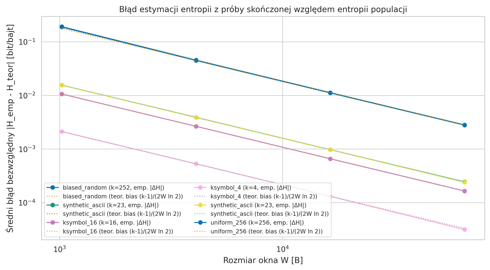
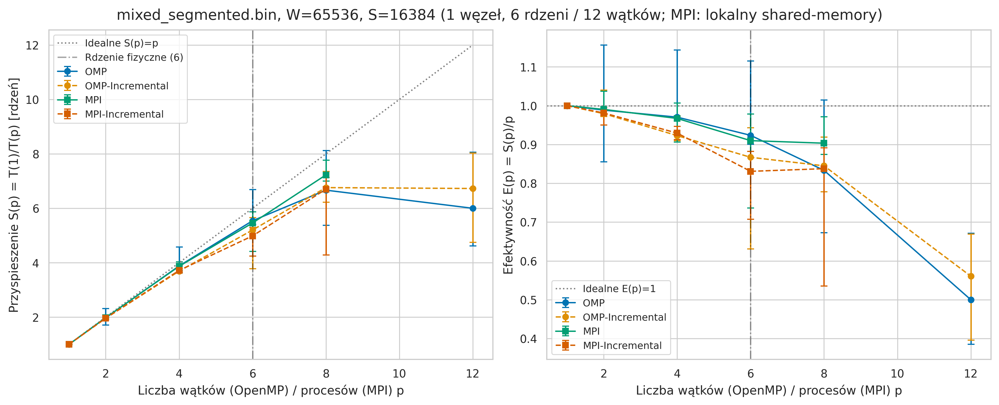
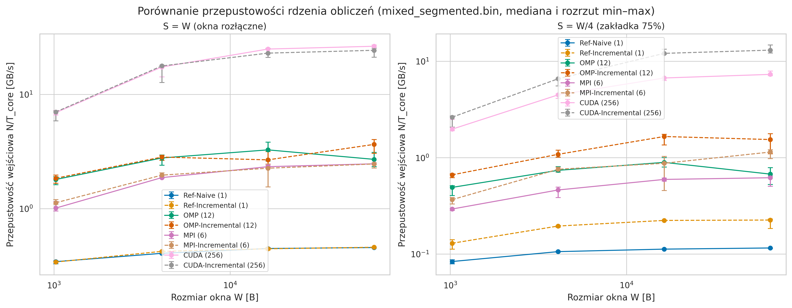
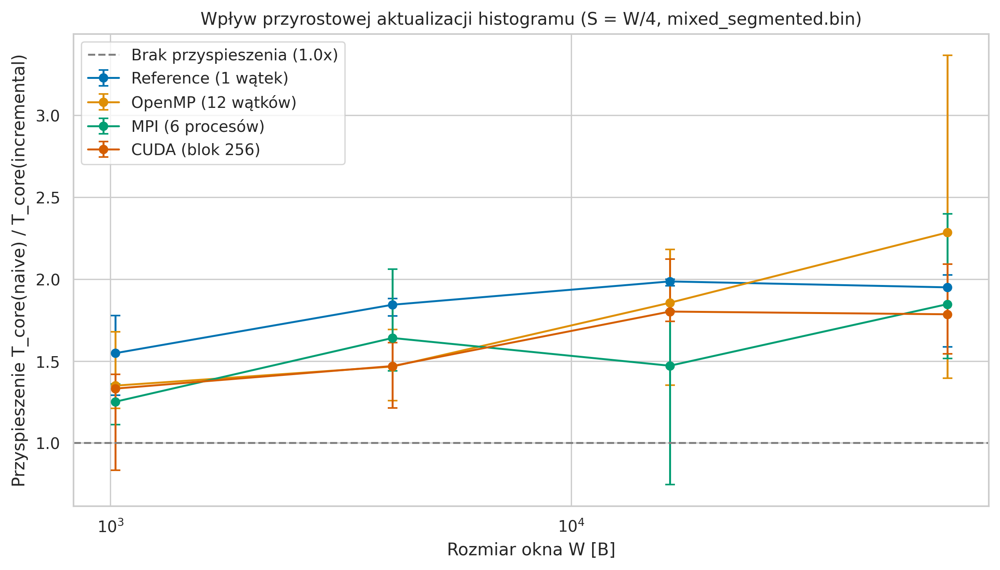
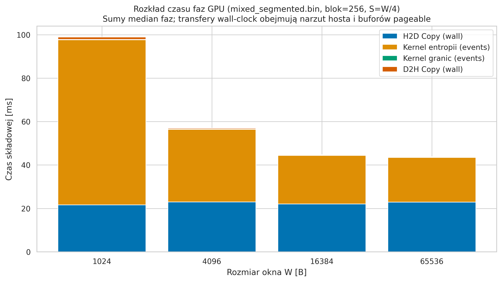
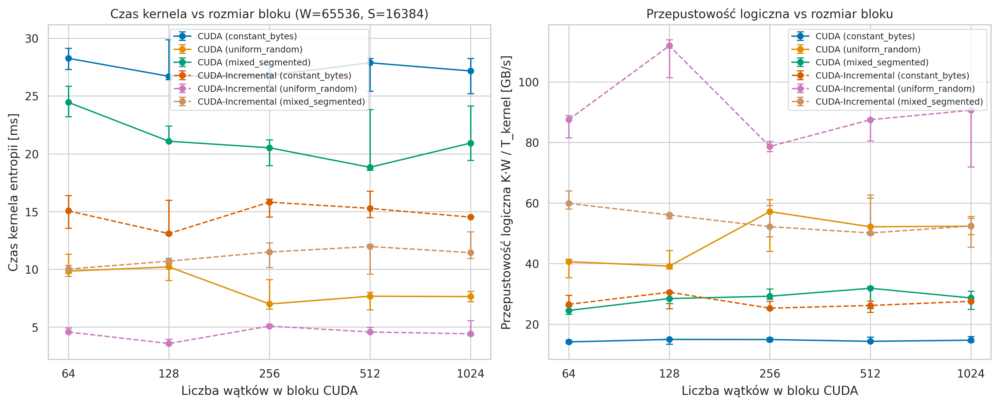
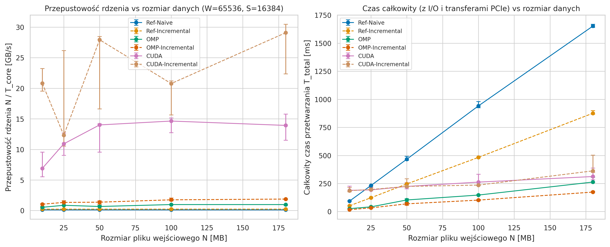
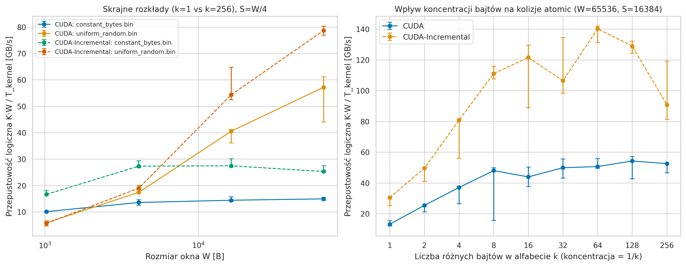
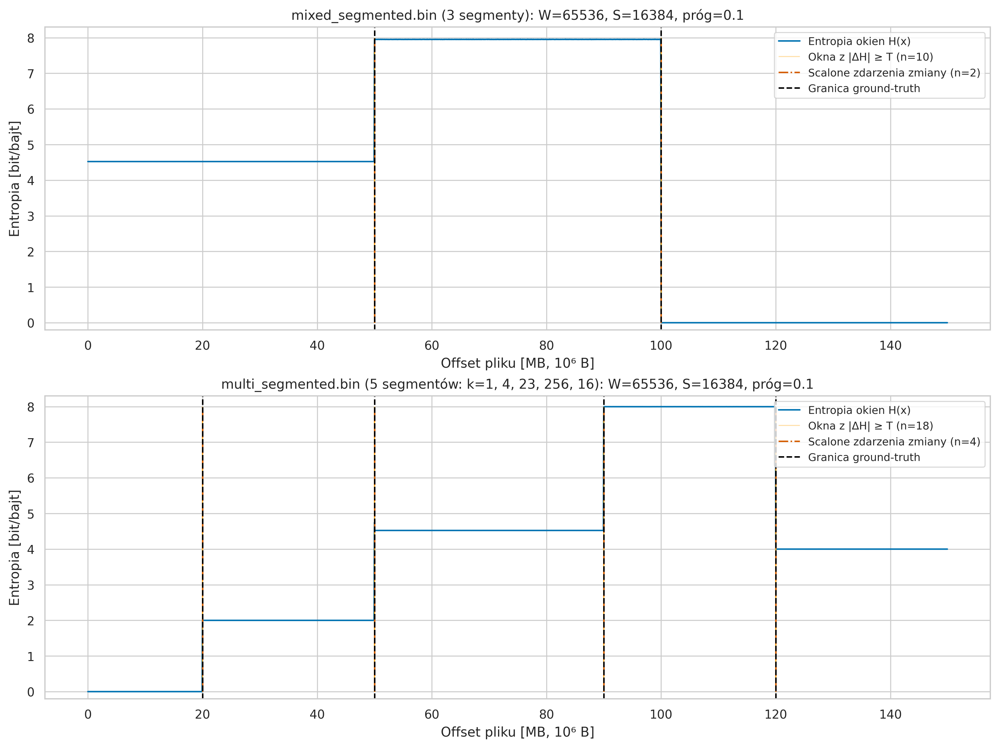

# Sprawozdanie z projektu C05: Entropia i segmentacja plików binarnych

**Przedmiot:** Programowanie Równoległe i Rozproszone (PRiR)  
**Temat:** C05 – Entropia i segmentacja plików binarnych (poziom łatwy, zespół 2-osobowy)  
**Autorzy:** Jan Wojnicki (nr albumu: 147020), Adrian Sajdak (nr albumu: 146992)  
**Technologie:** C++20 (referencja sekwencyjna), OpenMP, MPI (OpenMPI), NVIDIA CUDA  
**Rozszerzenie dla zespołu 2-osobowego:** Przyrostowa aktualizacja przesuwnego histogramu (`--mode incremental`) oraz jej porównanie z wariantem naiwnym (`--mode naive`) we wszystkich czterech technologiach.

---

## 1. Cel projektu i sformułowanie problemu

Celem projektu jest wyznaczenie profilu entropii Shannona rozkładu bajtów w przesuwnych oknach pliku binarnego oraz automatyczna detekcja granic obszarów różniących się strukturą statystyczną (np. tekstu ASCII, danych losowych/zaszyfrowanych, obszarów wypełnionych stałym bajtem lub danych o ograniczonym alfabecie).

Niech ciąg bajtów wejściowego pliku binarnego o długości $N$ będzie oznaczony jako $B = (b_0, b_1, \dots, b_{N-1})$, gdzie $b_j \in \{0, 1, \dots, 255\}$. Dla zadanej długości okna $W \ge 1$ oraz kroku przesunięcia $S \ge 1$:

1. **Liczba pełnych okien $K$ i obsługa końcówki pliku:**  
   Analizowane są wyłącznie pełne okna mieszczące się w granicach pliku:
   $$K = \begin{cases} 0 & \text{gdy } N < W, \\ 1 + \left\lfloor \frac{N - W}{S} \right\rfloor & \text{gdy } N \ge W. \end{cases}$$
   Początek $i$-tego okna ($i \in \{0, \dots, K-1\}$) znajduje się pod globalnym offsetem bajtowym $\text{offset}_i = i \cdot S$ i obejmuje przedział $[i \cdot S,\; i \cdot S + W)$.
   - Bajty końcowe poza ostatnim pełnym oknem w liczbie $N_{\text{trail}} = N - ((K - 1)S + W)$ (lub $N$ gdy $K = 0$) nie tworzą niepełnego okna (unika to sztucznego zaniżenia estymatora entropii na krótszej próbie na końcu pliku) i są jawnie raportowane na `stderr` (`omitted_trailing_bytes`).
   - Gdy krok $S > W$, pomiędzy sąsiednimi oknami powstają niepokryte przerwy o łącznym rozmiarze $N_{\text{gap}} = (K - 1)(S - W)$ bajtów, również raportowane na `stderr` (`uncovered_gap_bytes`).

2. **Histogram i entropia Shannona:**  
   W każdym oknie $i$ wyznaczany jest 256-elementowy histogram częstości bajtów $c_i[v] = \sum_{j=0}^{W-1} \mathbf{1}(b_{iS+j} = v)$ dla $v \in \{0, \dots, 255\}$. Prawdopodobieństwo empiryczne wynosi $p_i(v) = \frac{c_i[v]}{W}$. Entropia Shannona wyrażona w bitach na bajt (zakres $[0, 8]$):
   $$H_i = -\sum_{\substack{v=0 \\ c_i[v] > 0}}^{255} p_i(v) \log_2 p_i(v).$$
   Składniki o zerowym prawdopodobieństwie ($c_i[v] = 0$) są jawnie pomijane zgodnie z granicą $\lim_{p \to 0^+} p \log_2 p = 0$.

3. **Detekcja granic i scalanie sąsiednich przekroczeń progu:**  
   Dla każdego okna $i \ge 1$ wyznaczana jest podpisana różnica $\Delta H_i = H_i - H_{i-1}$ (dla $i = 0$ przyjmujemy $\Delta H_0 = 0$). Okno zostaje oznaczone flagą granicy (`is_boundary = 1`) wtedy i tylko wtedy, gdy:
   $$|\Delta H_i| \ge T,$$
   gdzie $T \ge 0$ jest zadanym progiem.  
   Ponieważ dla nakładających się okien ($S < W$) pojedyncza fizyczna granica między segmentami w pliku jest przecinana przez około $W/S$ kolejnych okien, skok entropii rozkłada się na kilka sąsiednich okien przekraczających próg $T$. W projekcie zaimplementowano mechanizm **scalania sąsiednich przekroczeń progu** (`merge_boundaries` w [`common/io.cpp`](common/io.cpp), opcja `--events`), który grupuje każdy maksymalny spójny ciąg okien $[i_{\text{first}}, i_{\text{last}}]$ z flagą `is_boundary = 1` w pojedyncze zdarzenie zmiany (`BoundaryEvent`) i estymuje położenie fizycznej granicy jako środek przedziału przejściowego:
   $$\hat{x}_{\text{granica}} = \left\lfloor \frac{(i_{\text{first}} - 1)S + (i_{\text{last}}S + W)}{2} \right\rfloor.$$

> **Uwaga domenowa:** Wysoka entropia (~8 bitów/bajt) wskazuje na równomierny rozkład bajtów, co jest charakterystyczne zarówno dla zaszyfrowanych lub spakowanych złośliwych ładunków, jak i całkowicie legalnych archiwów (`ZIP`, `GZ`), multimediów (`JPEG`, `MP4`) czy generatorów pseudolosowych. Sama wartość entropii nie rozstrzyga o złośliwości ani zaszyfrowaniu pliku.

---

## 2. Architektura rozwiązania i udział kodu własnego

### 2.1. Udział kodu własnego i bibliotek
Cały rdzeń obliczeniowy — budowa histogramów, aktualizacja przyrostowa, wyznaczanie entropii Shannona, redukcja równoległa w pamięci współdzielonej GPU, podział domenowy z zakładką w MPI, detekcja progowa i scalanie zdarzeń zmian — został **napisany w 100% samodzielnie** (pliki [`common/compute.cpp`](common/compute.cpp), [`common/io.cpp`](common/io.cpp), [`src/reference.cpp`](src/reference.cpp), [`src/openmp.cpp`](src/openmp.cpp), [`src/mpi.cpp`](src/mpi.cpp), [`src/cuda_entropy.cu`](src/cuda_entropy.cu)). Biblioteki zewnętrzne użyte są wyłącznie do obsługi standardowego wejścia/wyjścia (`C++20 STL`), uruchomienia równoległego (`OpenMP`, `OpenMPI`, `CUDA Runtime API`) oraz generowania wykresów w Pythonie (`matplotlib`, `seaborn`, `pandas`, `numpy`).

### 2.2. Wariant naiwny vs wariant przyrostowy (zakres dla zespołu 2-osobowego)

| Cecha | Wariant naiwny (`--mode naive`) | Wariant przyrostowy (`--mode incremental`) |
|---|---|---|
| **Zasada działania** | Dla każdego okna $i \in \{0, \dots, K-1\}$ zeruje histogram `hist[256]` i zlicza wszystkie $W$ bajtów okna od nowa. | Buduje pełny histogram tylko dla pierwszego okna podprzedziału ($W$ operacji), a dla każdego kolejnego okna przy $S < W$ odejmuje $S$ bajtów opuszczających okno (`--hist[b_old]`) i dodaje $S$ bajtów wchodzących (`++hist[b_new]`). Gdy $S \ge W$, okna są rozłączne i histogram jest przebudowywany od nowa. |
| **Koszt aktualizacji histogramu na okno** | $W$ inkrementacji + 256 zerowań | $2S$ aktualizacji (dla $S < W$) |
| **Teoretyczny stosunek liczby operacji na bajtach** | $1{,}00\times$ (punkt odniesienia) | $\frac{W}{2S}$ (np. dla $S = W/4$ dokładnie **$2{,}00\times$ mniej** operacji na pamięci; dla $S = W/16$ aż $8{,}00\times$ mniej) |
| **Koszt wyznaczenia entropii z histogramu** | 256 koszyków ($\le 256$ wywołań `log2`) | 256 koszyków ($\le 256$ wywołań `log2`) |
| **Zależności między oknami** | Brak – każde okno całkowicie niezależne | Zależność łańcuchowa w obrębie spójnego pasma okien przydzielonego do wątku / procesu / bloku GPU |

### 2.3. Podział obliczeń, synchronizacja i komunikacja w 4 implementacjach

#### 1. Implementacja referencyjna ([`src/reference.cpp`](src/reference.cpp), [`common/compute.cpp`](common/compute.cpp))
- Wykonywana sekwencyjnie w jednym wątku CPU.
- Stanowi wyrocznię dokładności numerycznej (64-bitowa arytmetyka zmiennoprzecinkowa `double`, sumowanie w kolejności indeksów koszyków $0 \dots 255$).

#### 2. Implementacja OpenMP ([`src/openmp.cpp`](src/openmp.cpp))
- **Brak współdzielonych liczników przy każdym bajcie:** W bloku `#pragma omp parallel` każdy wątek alokuje własną, prywatną tablicę `c05::Histogram histogram{}` (`std::array<uint32_t, 256>`, 1 KB mieszczący się w całości w pamięci podręcznej L1 rdzenia). Eliminuje to całkowicie operacje atomowe na CPU oraz zjawisko *false sharing*.
- **Tryb `naive`:** Pętla po oknach rozdzielana jest dyrektywą `#pragma omp for schedule(static)`. Ponieważ koszt każdego okna o stałej długości $W$ jest identyczny, harmonogram statyczny zapewnia idealne równoważenie obciążenia bez narzutu dynamicznego przydziału.
- **Tryb `incremental`:** Zbiór $K$ okien dzielony jest na $P$ spójnych pasm o rozmiarach różniących się o co najwyżej 1 okno (`base = K / P`, `extra = K % P`). Każdy wątek $t \in \{0, \dots, P-1\}$ wywołuje `compute_incremental` na swoim paśmie $[first_t, first_t + count_t)$. Koszt inicjalizacji pełnego histogramu ponoszony jest tylko raz na wątek (dla pierwszego okna pasma).
- **Synchronizacja:** Jedynie niejawna bariera na końcu regionu `#pragma omp parallel` przed detekcją granic.

#### 3. Implementacja MPI ([`src/mpi.cpp`](src/mpi.cpp))
- **Podział domenowy z zakładką (halo) bez duplikacji wyników:** Każde z $K$ okien ma dokładnie jednego właściciela – proces $r \in \{0, \dots, P-1\}$ otrzymuje spójny przedział indeksów okien $[first_r, first_r + count_r)$, gdzie $count_r = \lfloor K/P \rfloor + \mathbf{1}(r < K \bmod P)$. Dzięki temu żadne okno na granicy podobszarów nie jest obliczane podwójnie.
- **Obliczenie zakładki bajtowej:** Aby proces $r$ mógł samodzielnie obliczyć wszystkie swoje $count_r$ okien (w tym ostatnie okno zaczynające się pod globalnym offsetem $(first_r + count_r - 1)S$), potrzebuje spójnego fragmentu pliku zaczynającego się od bajtu `byte_offset[r] = first_r * S` o długości:
  $$\text{byte\_count}[r] = \begin{cases} 0 & \text{gdy } count_r = 0, \\ (count_r - 1)S + W & \text{gdy } count_r > 0. \end{cases}$$
  Dla $S < W$ sąsiednie fragmenty bajtowe na procesie głównym nakładają się na siebie na odcinku $W - S$ bajtów (zakładka *halo*).
- **Komunikacja:**
  1. `MPI_Bcast` rozsyła 64-bitowy rozmiar pliku $N$, dzięki czemu każdy proces lokalnie wylicza identyczny rozkład okien i offsetów (obsługiwany jest także przypadek brzegowy $P > K$, w którym nadmiarowe procesy mają $count_r = 0$).
  2. Ponieważ obszary źródłowe na procesie 0 nakładają się (co wyklucza standardowe `MPI_Scatterv` bez powielania bufora), proces 0 kopiuje własny fragment lokalnie i rozsyła fragmenty do procesów $1 \dots P-1$ za pomocą nieblokujących wywołań `MPI_Isend` zakończonych wspólnym `MPI_Waitall`, a pozostałe procesy odbierają dane przez `MPI_Recv`.
  3. Każdy proces oblicza wektor `local_entropy` dla swoich okien (w trybie `naive` lub `incremental`).
  4. Wyniki zbierane są w kolejności globalnych indeksów okien wywołaniem `MPI_Gatherv` z tablicą przesunięć `offsets[r] = first_r`, co zachowuje globalne pozycje bajtowe $i \cdot S$ w wynikowym pliku CSV.
  5. Czas rdzenia $T_{\text{core}}$ wyznaczany jest pomiędzy barierami `MPI_Barrier` i redukowany operacją `MPI_Reduce(..., MPI_MAX, ...)` (czas najwolniejszego procesu).

#### 4. Implementacja CUDA ([`src/cuda_entropy.cu`](src/cuda_entropy.cu))
- **Pamięć współdzielona per blok:** Każdy blok wątków posiada w pamięci `shared memory` własny histogram `__shared__ unsigned int s_hist[256]` (1 KB) oraz tablicę składników entropii `__shared__ double s_terms[256]` (2 KB). Żaden blok nie współdzieli histogramu z innym blokiem, dzięki czemu nie występują globalne operacje atomowe w pamięci DRAM GPU.
- **Tryb `naive` (`histogram_entropy_kernel`):**
  1. Pętla `grid-stride` przydziela kolejne okna do bloków (`index = blockIdx.x; index < count; index += gridDim.x`).
  2. Wątki bloku równolegle zerują `s_hist[0..255]` $\to$ `__syncthreads()`.
  3. Wątki bloku czytają bajty okna w sposób koalescencyjny (`for (j = threadIdx.x; j < W; j += blockDim.x)`) i aktualizują koszyki przez `atomicAdd(&s_hist[data[offset + j]], 1U)` w pamięci współdzielonej $\to$ `__syncthreads()`.
  4. Funkcja `__device__ block_entropy` oblicza 256 składników $-p \log_2 p$ (lub `0.0` dla $c = 0$) i wykonuje **drzewiastą redukcję równoległą** w `s_terms[256]` dla kroków `stride = 128, 64, ..., 1` (z wewnętrzną pętlą `for (bin = threadIdx.x; bin < stride; bin += blockDim.x)`, co gwarantuje poprawność także dla bloków 64- i 128-wątkowych). Wątek 0 zapisuje `d_entropy[index] = s_terms[0]`.
- **Tryb `incremental` (`incremental_entropy_kernel`):**
  1. Zbiór $K$ okien dzielony jest na pasma po `windows_per_block` kolejnych okien (ograniczone od góry przez 64 okna na pasmo w celu zachowania równoważenia obciążenia między multiprocesorami SM; gdy $S \ge W$, pasmo ma długość 1).
  2. Pierwsze okno pasma budowane jest w całości (`W` wywołań `atomicAdd`).
  3. Dla każdego kolejnego okna w paśmie (gdy $S < W$) wątki bloku wykonują jedynie $S$ odjęć `atomicSub(&s_hist[data[old_start + j]], 1U)` oraz $S$ dodań `atomicAdd(&s_hist[data[old_start + W + j]], 1U)` w pamięci współdzielonej. Ze względu na przemienność i łączność dodawania modularnego `uint32_t`, dowolny przeplot wykonania `atomicSub` i `atomicAdd` pomiędzy wątkami bloku daje po barierze `__syncthreads()` dokładny histogram nowego okna.
- **Detekcja granic na GPU (`boundary_flags_kernel`):** Drugi kernel w pętli `grid-stride` wyznacza dla każdego okna flagę `d_flags[i] = (i != 0 && fabs(d_entropy[i] - d_entropy[i-1]) >= threshold)`. Host po transferze `D2H` weryfikuje spójność flag i braku wartości `NaN`/`Inf`.

---

## 3. Konfiguracja sprzętowa i programowa oraz metodologia pomiarów

### 3.1. Środowisko testowe
Wszystkie pomiary przeprowadzono na tej samej maszynie fizycznej:
- **Procesor (CPU):** AMD Ryzen 5 2600 Six-Core Processor (architektura Zen+, **1 węzeł**, **6 rdzeni fizycznych**, **12 wątków logicznych SMT**).
- **Pamięć operacyjna (RAM):** 16 GB DDR4 (11,68 GB przydzielone dla podsystemu Linux WSL2, `/dev/shm` powiększone do 2 GB dla transportu współdzielonego MPI).
- **Karta graficzna (GPU):** NVIDIA GeForce GTX 1660 (architektura Turing `TU116`, compute capability **7.5**, **22 multiprocesory SM**, 1408 rdzeni CUDA, 6144 MB pamięci GDDR5, sterownik NVIDIA 610.88 / CUDA UMD 13.3).
- **System i kompilatory:** Ubuntu 24.04 LTS (jądro Linux 5.15.167.4-microsoft-standard-WSL2), `GCC 13.3.0` (`-std=c++20 -O3 -march=native -Wall -Wextra -fopenmp`), `OpenMPI 4.1.6`, `NVIDIA CUDA Toolkit 12.6.85` (`nvcc -O3 -arch=sm_75 -lineinfo`, bez `--use_fast_math`), `CMake 3.28.3`, `Python 3.12.3`.

### 3.2. Metodologia pomiarowa
1. **Rozdzielenie czasu rdzenia ($T_{\text{core}}$) i czasu całkowitego ($T_{\text{total}}$):**
   - $T_{\text{core}}$ obejmuje wyłącznie wyznaczenie histogramów i entropii dla wszystkich $K$ okien (na CPU: `std::chrono::steady_clock`, w MPI: `MPI_Wtime()` po barierze z redukcją `MPI_MAX`, na GPU: czas wykonania kernela `T_entropy_kernel_event_s` zmierzony za pomocą `cudaEventElapsedTime` po pełnej synchronizacji `cudaDeviceSynchronize()`).
   - $T_{\text{total}}$ obejmuje pełny czas od rozpoczęcia wczytywania pliku binarnego, przez alokację pamięci, inicjalizację kontekstu/komunikację/transfery `H2D` i `D2H`, wyznaczenie granic i scalenie zdarzeń, aż do zamknięcia i opróżnienia buforów (`flush` + `close`) wynikowego pliku CSV.
2. **Rozgrzewka i powtórzenia:**
   - Dla każdej z **134 konfiguracji** w głównym eksperymencie oraz we wszystkich eksperymentach dodatkowych wykonywany jest **1 przebieg rozgrzewkowy** (odrzucany z wyników CSV, zapisywany w logach `r0`) oraz **5 niezależnych pomiarów właściwych** (`run_id = 1..5`).
   - Kolejność wykonywania konfiguracji została losowo przetasowana ze stałym ziarnem (`seed = 2026`), aby wyeliminować dryft termiczny.
   - Dla OpenMP wymuszono przypięcie wątków do rdzeni (`OMP_DYNAMIC=FALSE`, `OMP_PROC_BIND=TRUE`, `OMP_PLACES=cores`).
   - Na wszystkich wykresach prezentowana jest **mediana** z 5 pomiarów oraz **rozrzut min–max** (dla przyspieszenia $S(p)$ konserwatywna obwiednia ilorazów $\left[\frac{T_{\min}(1)}{T_{\max}(p)},\; \frac{T_{\max}(1)}{T_{\min}(p)}\right]$).

### 3.3. Zbiory danych testowych
Skrypt [`scripts/generate_datasets.py`](scripts/generate_datasets.py) ze stałym ziarnem `seed = 2026` generuje deterministyczne pliki binarne (z weryfikacją sum kontrolnych SHA-256 w [`results/metadata.json`](results/metadata.json)):
1. **`constant_bytes.bin` (100 MB = $10^8$ B):** stałe bajty `0x00` ($k = 1$, $H_{\text{teor}} = 0{,}0$ bit/bajt) – maksymalna koncentracja aktualizacji w jednym koszyku `hist[0]`.
2. **`uniform_random.bin` (100 MB = $10^8$ B):** rozkład jednostajny na pełnym alfabecie 256 bajtów ($k = 256$, $H_{\text{teor}} = 8{,}0$ bit/bajt) – minimalna koncentracja w pojedynczym koszyku.
3. **`mixed_segmented.bin` (150 MB = $1{,}5 \times 10^8$ B):** 3 sklejone segmenty po 50 MB (znane granice `ground-truth` pod offsetami **50 000 000 B** oraz **100 000 000 B**):
   - $[0, 50\text{ MB})$: syntetyczny tekst ASCII z alfabetu 23-znakowego ($H_{\text{teor}} = \log_2 23 \approx 4{,}523562$ bit/bajt),
   - $[50\text{ MB}, 100\text{ MB})$: zniekształcony strumień losowy o wysokiej entropii ($k = 252$, $H_{\text{teor}} \approx 7{,}954650$ bit/bajt),
   - $[100\text{ MB}, 150\text{ MB})$: bajty zerowe ($k = 1$, $H_{\text{teor}} = 0{,}0$ bit/bajt).
4. **`multi_segmented.bin` (150 MB = $1{,}5 \times 10^8$ B):** 5 sklejonych segmentów o różnych długościach i rozkładach (4 znane granice pod offsetami **20 MB**, **50 MB**, **90 MB**, **120 MB**):
   - $[0, 20\text{ MB})$: zera ($k=1, H=0{,}0$), $[20, 50\text{ MB})$: 4 symbole ($k=4, H=2{,}0$), $[50, 90\text{ MB})$: ASCII ($k=23, H \approx 4{,}5236$), $[90, 120\text{ MB})$: pełny losowy ($k=256, H=8{,}0$), $[120, 150\text{ MB})$: 16 symboli ($k=16, H=4{,}0$).
5. **Seria `ksym_{k}.bin` (po 50 MB dla $k \in \{1, 2, 4, 8, 16, 32, 64, 128, 256\}$):** pliki o kontrolowanej liczbie równoprawdopodobnych bajtów ($H_{\text{teor}} = \log_2 k$) do ciągłego badania wpływu koncentracji bajtów na kolizje operacji atomowych w pamięci współdzielonej GPU.

---

## 4. Walidacja poprawności i analiza błędu entropii

### 4.1. Zgodność numeryczna między implementacjami
Przed przystąpieniem do pomiarów wydajności zweryfikowano wszystkie 4 grupy testów `CTest` ([`VALIDATION.txt`](VALIDATION.txt)). Dodatkowo w pliku [`results/backend_numerical_error.csv`](results/backend_numerical_error.csv) zmierzono różnicę względem sekwencyjnej referencji `Ref-Naive` na pełnym zbiorze `mixed_segmented.bin` ($W=65536, S=16384$, $K = 9152$ okna):

| Implementacja | Tryb | Maks. błąd $|\Delta H_{\max}|$ względem `Ref-Naive` | Średni błąd $|\Delta H_{\text{śr}}|$ | Identyczne flagi granic (`is_boundary`) |
|---|---|---:|---:|:---:|
| `Ref-Naive` | `naive` | `0.0` | `0.0` | Tak (100%) |
| `Ref-Incremental` | `incremental` | `0.0` | `0.0` | Tak (100%) |
| `OMP` (12 wątków) | `naive` | `0.0` | `0.0` | Tak (100%) |
| `OMP-Incremental` (12 wątków) | `incremental` | `0.0` | `0.0` | Tak (100%) |
| `MPI` (6 procesów) | `naive` | `0.0` | `0.0` | Tak (100%) |
| `MPI-Incremental` (6 procesów) | `incremental` | `0.0` | `0.0` | Tak (100%) |
| `CUDA` (blok 256) | `naive` | $1{,}688 \times 10^{-14}$ | $1{,}007 \times 10^{-15}$ | Tak (100%) |
| `CUDA-Incremental` (blok 256) | `incremental` | $1{,}688 \times 10^{-14}$ | $1{,}007 \times 10^{-15}$ | Tak (100%) |

Wszystkie warianty CPU (`Ref-Incremental`, `OMP`, `MPI`) są **bitowo identyczne** z referencją naiwną (`max_error = 0`), ponieważ wyznaczają identyczny histogram całkowitoliczbowy i sumują 256 koszyków w tej samej kolejności $0 \dots 255$. Na GPU (`CUDA` i `CUDA-Incremental`) różnica rzędu $10^{-15}\text{–}10^{-14}$ bit/bajt wynika wyłącznie z drzewiastej kolejności dodawania zmiennoprzecinkowego `double` w pamięci współdzielonej (`stride = 128, 64, ..., 1`) i jest o **8 rzędów wielkości mniejsza** od przyjętej tolerancji $\varepsilon = 10^{-6}$.

### 4.2. Błąd estymacji entropii z okna skończonego względem entropii teoretycznej
Zgodnie z teorią informacji estymator plug-in entropii Shannona z próby o skończonym rozmiarze $W$ jest obciążony ujemnie (średnio zaniża entropię populacji $H_{\text{teor}}$), a asymptotyczne obciążenie Millera–Madowa dla rozkładu o $k$ niezerowych symbolach wynosi:
$$\text{Bias}_{\text{MM}}(W, k) = \mathbb{E}[\hat{H}_W] - H_{\text{teor}} \approx -\frac{k - 1}{2 W \ln 2}.$$

Zestawienie zmierzonego błędu empirycznego wewnątrz jednorodnych segmentów ([`results/entropy_accuracy_summary.csv`](results/entropy_accuracy_summary.csv)):

| Segment (rozkład) | Liczba symboli $k$ | $H_{\text{teor}}$ [bit/B] | Rozmiar okna $W$ | Teoretyczny bias Millera–Madowa | Średni błąd podpisany $\overline{H_{\text{emp}} - H_{\text{teor}}}$ | Średni błąd bezwzględny $\overline{|H_{\text{emp}} - H_{\text{teor}}|}$ | Maks. błąd $|\Delta H|_{\max}$ |
|---|---:|---:|---:|---:|---:|---:|---:|
| `zeros` (`constant`) | 1 | $0{,}000000$ | $1024 \dots 65536$ | $0{,}000000$ | $0{,}000000$ | $0{,}000000$ | $0{,}000000$ |
| `ksymbol_4` | 4 | $2{,}000000$ | $1024$ | $-0{,}002113$ | $-0{,}002111$ | $0{,}002111$ | $0{,}016875$ |
| `ksymbol_4` | 4 | $2{,}000000$ | $65536$ | $-0{,}000033$ | $-0{,}000031$ | $0{,}000031$ | $0{,}000212$ |
| `ksymbol_16` | 16 | $4{,}000000$ | $1024$ | $-0{,}010567$ | $-0{,}010595$ | $0{,}010595$ | $0{,}033621$ |
| `ksymbol_16` | 16 | $4{,}000000$ | $65536$ | $-0{,}000165$ | $-0{,}000164$ | $0{,}000164$ | $0{,}000375$ |
| `synthetic_ascii` | 23 | $4{,}523562$ | $1024$ | $-0{,}015498$ | $-0{,}015559$ | $0{,}015559$ | $0{,}040818$ |
| `synthetic_ascii` | 23 | $4{,}523562$ | $4096$ | $-0{,}003874$ | $-0{,}003888$ | $0{,}003888$ | $0{,}010806$ |
| `synthetic_ascii` | 23 | $4{,}523562$ | $16384$ | $-0{,}000969$ | $-0{,}000969$ | $0{,}000969$ | $0{,}002188$ |
| `synthetic_ascii` | 23 | $4{,}523562$ | $65536$ | $-0{,}000242$ | $-0{,}000243$ | $0{,}000243$ | $0{,}000489$ |
| `uniform_256` | 256 | $8{,}000000$ | $1024$ | $-0{,}179632$ | $-0{,}191289$ | $0{,}191289$ | $0{,}270488$ |
| `uniform_256` | 256 | $8{,}000000$ | $4096$ | $-0{,}044908$ | $-0{,}045403$ | $0{,}045403$ | $0{,}060694$ |
| `uniform_256` | 256 | $8{,}000000$ | $16384$ | $-0{,}011227$ | $-0{,}011248$ | $0{,}011248$ | $0{,}015135$ |
| `uniform_256` | 256 | $8{,}000000$ | $65536$ | $-0{,}002807$ | $-0{,}002813$ | $0{,}002813$ | $0{,}003627$ |

**Wniosek:** Błąd estymacji entropii maleje odwrotnie proporcjonalnie do rozmiaru okna ($\propto W^{-1}$) i pokrywa się z teoretycznym wzorem Millera–Madowa z dokładnością lepszą niż $1\%$. Dla małego okna $W = 1024$ i pełnego alfabetu $k = 256$ losowe fluktuacje entropii między sąsiednimi oknami sięgają $0{,}1\text{–}0{,}27$ bit/bajt, co przy progu $T = 0{,}1$ może powodować fałszywe alarmy wewnątrz losowego segmentu; już od $W \ge 4096$ fluktuacje spadają poniżej $0{,}03$ bit/bajt.

---

## 5. Wyniki pomiarów wydajności i skalowania

### 5.1. Skalowanie silne CPU (OpenMP) i MPI (lokalne shared-memory)
Pomiary skalowania wykonano przy stałym rozmiarze problemu (`mixed_segmented.bin`, $N = 150\text{ MB}$, $W = 65536$, $S = 16384$, $K = 9152$ okna). Wzór przyspieszenia $S(p) = \frac{T_{\text{core}}(1)}{T_{\text{core}}(p)}$ oraz efektywności $E(p) = \frac{S(p)}{p}$ odnoszony jest do tej samej metody dla $p = 1$. Wszystkie pomiary MPI wykonano na **jednym komputerze lokalnym (1 węzeł, 6 rdzeni fizycznych / 12 wątków SMT)** – stanowią one pomiar lokalnej komunikacji w pamięci współdzielonej, a nie skalowalności klastra wielowęzłowego.

| Technologia i tryb | Liczba wątków / procesów $p$ | Mediana $T_{\text{core}}$ [ms] (zakres min–max) | Mediana $T_{\text{total}}$ [ms] | Przepustowość wejściowa $N/T_{\text{core}}$ [GB/s] | Przepustowość logiczna $KW/T_{\text{core}}$ [GB/s] | Przyspieszenie $S(p)$ | Efektywność $E(p)$ |
|---|---:|---:|---:|---:|---:|---:|---:|
| **`OMP` (`naive`)** | 1 | $1334{,}81$ $[1316{,}9..1539{,}7]$ | $1399{,}05$ | $0{,}11$ | $0{,}45$ | $1{,}00\times$ | $1{,}000$ |
| | 2 | $675{,}15$ $[665{,}8..769{,}7]$ | $760{,}42$ | $0{,}22$ | $0{,}89$ | $1{,}98\times$ | $0{,}989$ |
| | 4 | $343{,}87$ $[336{,}7..355{,}2]$ | $412{,}40$ | $0{,}44$ | $1{,}74$ | $3{,}88\times$ | $0{,}970$ |
| | 6 *(rdzenie fiz.)* | $240{,}88$ $[230{,}1..243{,}7]$ | $303{,}24$ | $0{,}62$ | $2{,}49$ | $5{,}54\times$ | $0{,}924$ |
| | 8 *(SMT)* | $200{,}21$ $[189{,}6..244{,}8]$ | $277{,}49$ | $0{,}75$ | $3{,}00$ | $6{,}67\times$ | $0{,}833$ |
| | 12 *(pełne SMT)* | $222{,}45$ $[191{,}1..285{,}0]$ | $299{,}91$ | $0{,}67$ | $2{,}70$ | $6{,}00\times$ | $0{,}500$ |
| **`OMP-Incremental`** | 1 | $655{,}20$ $[650{,}7..680{,}2]$ | $736{,}76$ | $0{,}23$ | $0{,}92$ | $1{,}00\times$ | $1{,}000$ |
| | 2 | $334{,}48$ $[326{,}9..334{,}7]$ | $397{,}05$ | $0{,}45$ | $1{,}79$ | $1{,}96\times$ | $0{,}979$ |
| | 4 | $177{,}50$ $[174{,}7..178{,}8]$ | $242{,}31$ | $0{,}85$ | $3{,}38$ | $3{,}69\times$ | $0{,}923$ |
| | 6 *(rdzenie fiz.)* | $125{,}95$ $[120{,}2..172{,}0]$ | $200{,}22$ | $1{,}19$ | $4{,}76$ | $5{,}20\times$ | $0{,}867$ |
| | 8 *(SMT)* | $96{,}92$ $[92{,}5..104{,}5]$ | $167{,}47$ | $1{,}55$ | $6{,}19$ | $6{,}76\times$ | $0{,}845$ |
| | 12 *(pełne SMT)* | $97{,}39$ $[84{,}7..137{,}1]$ | $166{,}56$ | $1{,}54$ | $6{,}16$ | $6{,}73\times$ | $0{,}561$ |
| **`MPI` (`naive`, lokalne)** | 1 | $1324{,}70$ $[1315{,}7..1366{,}7]$ | $1432{,}73$ | $0{,}11$ | $0{,}45$ | $1{,}00\times$ | $1{,}000$ |
| | 2 | $668{,}77$ $[658{,}8..673{,}3]$ | $770{,}77$ | $0{,}22$ | $0{,}90$ | $1{,}98\times$ | $0{,}990$ |
| | 4 | $342{,}44$ $[339{,}3..362{,}9]$ | $460{,}48$ | $0{,}44$ | $1{,}75$ | $3{,}87\times$ | $0{,}967$ |
| | 6 *(rdzenie fiz.)* | $242{,}64$ $[232{,}8..297{,}8]$ | $358{,}62$ | $0{,}62$ | $2{,}47$ | $5{,}46\times$ | $0{,}910$ |
| | 8 *(oversubscribe)* | $183{,}30$ $[175{,}9..188{,}0]$ | $295{,}97$ | $0{,}82$ | $3{,}27$ | $7{,}23\times$ | $0{,}903$ |
| **`MPI-Incremental` (lokalne)** | 1 | $655{,}00$ $[652{,}3..657{,}2]$ | $757{,}73$ | $0{,}23$ | $0{,}92$ | $1{,}00\times$ | $1{,}000$ |
| | 2 | $333{,}77$ $[330{,}2..343{,}4]$ | $441{,}17$ | $0{,}45$ | $1{,}80$ | $1{,}96\times$ | $0{,}981$ |
| | 4 | $176{,}21$ $[173{,}6..178{,}6]$ | $288{,}57$ | $0{,}85$ | $3{,}40$ | $3{,}72\times$ | $0{,}929$ |
| | 6 *(rdzenie fiz.)* | $131{,}39$ $[124{,}2..153{,}7]$ | $272{,}35$ | $1{,}14$ | $4{,}56$ | $4{,}99\times$ | $0{,}831$ |
| | 8 *(oversubscribe)* | $97{,}74$ $[92{,}2..152{,}4]$ | $212{,}59$ | $1{,}53$ | $6{,}14$ | $6{,}70\times$ | $0{,}838$ |

**Wnioski ze skalowania CPU/MPI:**
- W zakresie od $p = 1$ do $p = 6$ (liczba fizycznych rdzeni procesora Ryzen 5 2600) zarówno OpenMP, jak i MPI wykazują niemal liniowe skalowanie rdzenia obliczeń: efektywność przy $p = 6$ wynosi **$92{,}4\%$** dla `OMP`, **$91{,}0\%$** dla `MPI`, **$86{,}7\%$** dla `OMP-Incremental` i **$83{,}1\%$** dla `MPI-Incremental`.
- Powyżej 6 rdzeni fizycznych ($p = 8$ i $p = 12$) wykorzystywane są wątki logiczne SMT (Simultaneous Multithreading). Przejście z $p = 6$ na $p = 8$ daje jeszcze wzrost przyspieszenia z $5{,}54\times$ do $6{,}67\times$, natomiast przy $p = 12$ wątkach następuje nasycenie potoków wykonawczych i przepustowości pamięci podręcznej L1/L2 (efektywność spada do $0{,}50\text{–}0{,}56$).
- Czas całkowity $T_{\text{total}}$ w MPI jest o ok. $45\text{–}70\text{ ms}$ wyższy niż w OpenMP dla tej samej liczby wykonawców $p$, ponieważ w MPI proces 0 musi rozesłać 150 MB danych z zakładką przez bufory komunikacyjne (`T_distribute_s` $\approx 25\text{–}35\text{ ms}$) oraz zainicjalizować środowisko uruchomieniowe `orted`.

---

### 5.2. Porównanie wszystkich technologii oraz wariantu naiwnego i przyrostowego (zakres 2-osobowy)
Poniższa tabela zestawia mediany czasu rdzenia $T_{\text{core}}$, czasu całkowitego $T_{\text{total}}$ oraz przepustowości na zbiorze `mixed_segmented.bin` (150 MB) dla nakładających się okien $S = W/4$ (75% zakładki) przy kanonicznych zasobach (`Ref: 1`, `OMP: 12 wątków`, `MPI: 6 procesów`, `CUDA: 256 wątków/blok`):

| Rozmiar okna $W$ (krok $S = W/4$) | Implementacja | $T_{\text{core}}$ [ms] | $T_{\text{total}}$ [ms] | Przepustowość wejściowa $N/T_{\text{core}}$ [GB/s] | Przepustowość logiczna $KW/T_{\text{core}}$ [GB/s] | Przyspieszenie rdzenia wzgl. `Ref-Naive(1)` | Przyspieszenie `Incremental` vs `Naive` (ten sam backend) |
|---|---|---|---|---:|---:|---:|---:|
| **$W = 1024$** ($S = 256$, $K = 585\,934$) | `Ref-Naive (1)` | $1797{,}83$ | $2397{,}53$ | $0{,}08$ | $0{,}33$ | $1{,}00\times$ | — |
| | `Ref-Incremental (1)` | $1161{,}62$ | $1755{,}68$ | $0{,}13$ | $0{,}52$ | $1{,}55\times$ | **$1{,}55\times$** |
| | `OMP (12)` | $305{,}75$ | $911{,}60$ | $0{,}49$ | $1{,}96$ | $5{,}88\times$ | — |
| | `OMP-Incremental (12)` | $226{,}53$ | $839{,}79$ | $0{,}66$ | $2{,}65$ | $7{,}94\times$ | **$1{,}35\times$** |
| | `MPI (6)` | $512{,}68$ | $1268{,}29$ | $0{,}29$ | $1{,}17$ | $3{,}51\times$ | — |
| | `MPI-Incremental (6)` | $409{,}74$ | $1185{,}34$ | $0{,}37$ | $1{,}46$ | $4{,}39\times$ | **$1{,}25\times$** |
| | `CUDA (256)` | $76{,}02$ | $889{,}20$ | $1{,}97$ | $7{,}89$ | $23{,}65\times$ | — |
| | `CUDA-Incremental (256)` | $57{,}09$ | $862{,}61$ | $2{,}63$ | $10{,}51$ | $31{,}49\times$ | **$1{,}33\times$** |
| **$W = 4096$** ($S = 1024$, $K = 146\,481$) | `Ref-Naive (1)` | $1418{,}86$ | $1606{,}16$ | $0{,}11$ | $0{,}42$ | $1{,}00\times$ | — |
| | `Ref-Incremental (1)` | $769{,}69$ | $986{,}37$ | $0{,}19$ | $0{,}78$ | $1{,}84\times$ | **$1{,}84\times$** |
| | `OMP (12)` | $203{,}26$ | $397{,}97$ | $0{,}74$ | $2{,}95$ | $6{,}98\times$ | — |
| | `OMP-Incremental (12)` | $138{,}65$ | $334{,}60$ | $1{,}08$ | $4{,}33$ | $10{,}23\times$ | **$1{,}47\times$** |
| | `MPI (6)` | $325{,}08$ | $627{,}06$ | $0{,}46$ | $1{,}85$ | $4{,}36\times$ | — |
| | `MPI-Incremental (6)` | $198{,}17$ | $510{,}37$ | $0{,}76$ | $3{,}03$ | $7{,}16\times$ | **$1{,}64\times$** |
| | `CUDA (256)` | $33{,}47$ | $425{,}37$ | $4{,}48$ | $17{,}92$ | $42{,}39\times$ | — |
| | `CUDA-Incremental (256)` | $22{,}78$ | $398{,}77$ | $6{,}58$ | $26{,}34$ | $62{,}28\times$ | **$1{,}47\times$** |
| **$W = 16384$** ($S = 4096$, $K = 36\,618$) | `Ref-Naive (1)` | $1336{,}56$ | $1423{,}24$ | $0{,}11$ | $0{,}45$ | $1{,}00\times$ | — |
| | `Ref-Incremental (1)` | $673{,}11$ | $762{,}09$ | $0{,}22$ | $0{,}89$ | $1{,}99\times$ | **$1{,}99\times$** |
| | `OMP (12)` | $168{,}07$ | $270{,}03$ | $0{,}89$ | $3{,}57$ | $7{,}95\times$ | — |
| | `OMP-Incremental (12)` | $90{,}58$ | $183{,}75$ | $1{,}66$ | $6{,}62$ | $14{,}76\times$ | **$1{,}86\times$** |
| | `MPI (6)` | $252{,}61$ | $398{,}96$ | $0{,}59$ | $2{,}38$ | $5{,}29\times$ | — |
| | `MPI-Incremental (6)` | $171{,}71$ | $518{,}87$ | $0{,}87$ | $3{,}49$ | $7{,}78\times$ | **$1{,}47\times$** |
| | `CUDA (256)` | $22{,}36$ | $308{,}09$ | $6{,}71$ | $26{,}83$ | $59{,}77\times$ | — |
| | `CUDA-Incremental (256)` | $12{,}41$ | $300{,}13$ | $12{,}09$ | $48{,}34$ | $107{,}68\times$ | **$1{,}80\times$** |
| **$W = 65536$** ($S = 16384$, $K = 9152$) | `Ref-Naive (1)` | $1300{,}18$ | $1359{,}41$ | $0{,}12$ | $0{,}46$ | $1{,}00\times$ | — |
| | `Ref-Incremental (1)` | $666{,}94$ | $784{,}00$ | $0{,}22$ | $0{,}90$ | $1{,}95\times$ | **$1{,}95\times$** |
| | `OMP (12)` | $222{,}45$ | $299{,}91$ | $0{,}67$ | $2{,}70$ | $5{,}84\times$ | — |
| | `OMP-Incremental (12)` | $97{,}39$ | $166{,}56$ | $1{,}54$ | $6{,}16$ | $13{,}35\times$ | **$2{,}28\times$** |
| | `MPI (6)` | $242{,}64$ | $358{,}62$ | $0{,}62$ | $2{,}47$ | $5{,}36\times$ | — |
| | `MPI-Incremental (6)` | $131{,}39$ | $272{,}35$ | $1{,}14$ | $4{,}56$ | $9{,}90\times$ | **$1{,}85\times$** |
| | `CUDA (256)` | $20{,}52$ | $285{,}43$ | $7{,}31$ | $29{,}23$ | $63{,}37\times$ | — |
| | `CUDA-Incremental (256)` | $11{,}49$ | $290{,}30$ | $13{,}05$ | $52{,}18$ | **$113{,}12\times$** | **$1{,}78\times$** |

**Analiza porównawcza wariantu naiwnego i przyrostowego:**
- Dla $S = W/4$ teoretyczny współczynnik redukcji aktualizacji koszyków wynosi $\frac{W}{2S} = 2{,}00\times$.
- Dla dużych okien ($W = 16384$ i $W = 65536$), gdzie czas zliczania bajtów dominuje nad stałym kosztem 256 wywołań `log2(p)` przy obliczaniu entropii, empiryczne przyspieszenie wariantu `incremental` względem `naive` osiąga **$1{,}95\text{–}1{,}99\times$** w wersji referencyjnej, **$1{,}86\text{–}2{,}28\times$** w OpenMP, **$1{,}85\times$** w MPI oraz **$1{,}78\text{–}1{,}80\times$** w CUDA (a dla bloku 64-wątkowego w CUDA nawet **$2{,}44\times$**: spadek z $24{,}45\text{ ms}$ do $10{,}02\text{ ms}$).
- Dla małego okna $W = 1024$ ($S = 256$) zysk z aktualizacji przyrostowej jest mniejszy ($1{,}25\text{–}1{,}55\times$), ponieważ stały koszt obliczania 256 logarytmów `log2` na każde okno stanowi już znaczącą część czasu wykonania okna ($256$ operacji zmiennoprzecinkowych względem $2S = 512$ operacji całkowitoliczbowych).
- Dla okien rozłącznych ($S = W$, prawa część wykresu `throughput_comparison.png`) oba warianty wykonują dokładnie tę samą liczbę operacji i osiągają identyczną przepustowość.

---

### 5.3. Analiza GPU: koszt transferów PCIe, rozmiar bloku i rozmiar danych

#### 1. Koszt transferów H2D/D2H i narzut uruchomieniowy GPU
Rozkład czasu poszczególnych faz GPU na zbiorze `mixed_segmented.bin` (150 MB, blok 256, $S = W/4$):

| Rozmiar okna $W$ | Liczba okien $K$ | Transfer `H2D` wall (`event`) [ms] | Kernel entropii (`event`) [ms] | Kernel granic (`event`) [ms] | Transfer `D2H` wall (`event`) [ms] | Postprocessing CPU [ms] | Czas całkowity $T_{\text{total}}$ [ms] | Udział transferów H2D+D2H w czasie GPU |
|---:|---:|---:|---:|---:|---:|---:|---:|---:|
| $1024$ | $585\,934$ | $21{,}69$ ($19{,}47$) | $76{,}01$ | $0{,}161$ | $1{,}11$ ($1{,}03$) | $1{,}225$ | $889{,}20$ | $23{,}0\%$ |
| $4096$ | $146\,481$ | $23{,}01$ ($19{,}41$) | $33{,}47$ | $0{,}130$ | $0{,}44$ ($0{,}37$) | $0{,}320$ | $425{,}37$ | $41{,}1\%$ |
| $16384$ | $36\,618$ | $22{,}04$ ($18{,}57$) | $22{,}36$ | $0{,}100$ | $0{,}28$ ($0{,}19$) | $0{,}079$ | $308{,}09$ | $49{,}8\%$ |
| $65536$ | $9\,152$ | $22{,}94$ ($19{,}38$) | $20{,}52$ | $0{,}135$ | $0{,}23$ ($0{,}17$) | $0{,}023$ | $285{,}43$ | **$52{,}9\%$** |

- **Transfer `H2D` (150 MB):** zajmuje stałe $\approx 22\text{–}23\text{ ms}$ (ok. $19{,}4\text{ ms}$ na strumieniu CUDA, co odpowiada efektywnej przepustowości magistrali PCIe 3.0 z bufora pageable $\approx 7{,}7\text{ GB/s}$). Dla $W = 65536$ sam transfer wejściowy `H2D` trwa dłużej niż wykonanie kernela obliczeniowego ($22{,}94\text{ ms}$ vs $20{,}52\text{ ms}$ w trybie `naive` oraz $11{,}49\text{ ms}$ w trybie `incremental`)!
- **Różnica między $T_{\text{core}}$ a $T_{\text{total}}$:** Podczas gdy w samym rdzeniu obliczeń GPU (`CUDA-Incremental`) osiąga $11{,}49\text{ ms}$ (przyspieszenie **$113{,}1\times$** względem `Ref-Naive` i **$8{,}5\times$** względem 12-wątkowego `OMP-Incremental`), w czasie całkowitym $T_{\text{total}}$ narzut inicjalizacji kontekstu CUDA w sterowniku WDDM ($T_{\text{setup}} \approx 210\text{–}240\text{ ms}$) oraz transfer PCIe sprawiają, że dla pojedynczego uruchomienia procesu `OMP-Incremental (12)` kończy pracę szybciej ($T_{\text{total}} = 166{,}56\text{ ms}$) niż `CUDA` ($T_{\text{total}} = 285{,}43\text{ ms}$). Natomiast dla `W = 1024` głównym składnikiem $T_{\text{total}}$ we wszystkich technologiach staje się formatowanie i zapis $585\,934$ wierszy tekstu pliku CSV ($\approx 540\text{ ms}$).

#### 2. Wpływ konfiguracji bloku wątków CUDA (`threads_per_block`)
Wyniki dla $W = 65536, S = 16384$ przy zmianie rozmiaru bloku w zakresie $\{64, 128, 256, 512, 1024\}$:

| Rozmiar bloku | `CUDA (naive)` – `constant` [ms] (log GB/s) | `CUDA (naive)` – `uniform` [ms] (log GB/s) | `CUDA (naive)` – `mixed` [ms] (log GB/s) | `CUDA-Inc` – `mixed` [ms] (log GB/s) |
|---:|---:|---:|---:|---:|
| **64** | $23{,}80$ ($16{,}80$) | $13{,}05$ ($30{,}63$) | $24{,}45$ ($24{,}53$) | **$10{,}02$ ($59{,}88$)** |
| **128** | $22{,}81$ ($17{,}53$) | $11{,}55$ ($34{,}61$) | $21{,}08$ ($28{,}45$) | $10{,}70$ ($56{,}06$) |
| **256** | $23{,}78$ ($16{,}81$) | $11{,}09$ ($36{,}04$) | $20{,}52$ ($29{,}23$) | $11{,}49$ ($52{,}18$) |
| **512** | $24{,}33$ ($16{,}43$) | $10{,}77$ ($37{,}11$) | **$18{,}83$ ($31{,}86$)** | $11{,}97$ ($50{,}12$) |
| **1024** | $27{,}58$ ($14{,}50$) | $11{,}83$ ($33{,}78$) | $20{,}92$ ($28{,}67$) | $11{,}44$ ($52{,}43$) |

- W trybie `naive` na danych losowych i mieszanych optymalny rozmiar bloku to **256–512 wątków** ($18{,}83\text{–}20{,}52\text{ ms}$). Zwiększenie bloku do 1024 wątków pogarsza czas wykonania, ponieważ przy 1024 wątkach na blok więcej warpów w obrębie tego samego bloku rywalizuje o tę samą tablicę `s_hist[256]` w pamięci współdzielonej, a liczba równocześnie rezydujących bloków na SM spada do 1.
- W trybie `incremental` (`CUDA-Incremental`) oraz dla danych stałych (`constant_bytes.bin`) najlepsze wyniki dają mniejsze bloki (**64–128 wątków**), ponieważ zmniejszają jednoczesną konkurencję operacji atomowych na jednej tablicy `s_hist[256]`, pozwalając jednocześnie na rezydowanie wielu niezależnych bloków (z osobnymi tablicami `s_hist`) na każdym multiprocesorze SM!

#### 3. Wpływ rozmiaru danych wejściowych ($N \in \{10, 25, 50, 100, 180\}\text{ MB}$)
Wyniki ze zbioru [`results/gpu_datasize_scaling.csv`](results/gpu_datasize_scaling.csv) ($W = 65536, S = 16384$):

- Przepustowość CPU (`Ref-Naive` $\approx 0{,}11\text{ GB/s}$, `Ref-Incremental` $\approx 0{,}23\text{ GB/s}$) jest stała niezależnie od rozmiaru pliku.
- Przepustowość rdzenia GPU rośnie wraz z rozmiarem danych od $6{,}89\text{ GB/s}$ (dla 10 MB, gdzie $K = 607$ okien nie nasyca w pełni zasobów GPU) do **$14{,}64\text{ GB/s}$** (`CUDA`) oraz **$29{,}09\text{ GB/s}$** (`CUDA-Incremental`, czyli **$116\text{ GB/s}$ przepustowości logicznej okien**) dla $N = 180\text{ MB}$.

---

### 5.4. Badanie wpływu koncentracji bajtów na konkurencję operacji atomowych w GPU

W architekturze Turing (GTX 1660) pamięć współdzielona posiada 32 banki 32-bitowe. Tablica `s_hist[256]` rozkłada 256 koszyków po 8 koszyków na każdy bank. Gdy wątki tego samego warpu wykonują `atomicAdd` pod ten sam adres (np. `s_hist[0]` dla pliku zerowego), sprzęt musi zserializować aktualizacje (lub wykonać częściową agregację warp-level, jednak wszystkie 8–32 warpy bloku uderzają w ten sam koszyk `s_hist[0]`).

W eksperymencie [`results/atomic_contention_ksymbol.csv`](results/atomic_contention_ksymbol.csv) ($N = 50\text{ MB}, W = 65536, S = 16384$, blok 256) zbadano zależność czasu kernela i przepustowości logicznej od liczby różnych bajtów $k \in \{1, 2, 4, 8, 16, 32, 64, 128, 256\}$ (prawdopodobieństwo kolizji w jednym koszyku wynosi $1/k$):

| Liczba symboli $k$ | Koncentracja $1/k$ | $H_{\text{teor}}$ [bit/B] | `CUDA (naive)` $T_{\text{kernel}}$ [ms] | `CUDA (naive)` przepustowość logiczna [GB/s] | `CUDA-Inc` $T_{\text{kernel}}$ [ms] | `CUDA-Inc` przepustowość logiczna [GB/s] | Przyspieszenie względem $k=1$ (`naive` / `inc`) |
|---:|---:|---:|---:|---:|---:|---:|---:|
| **1** (`0x00`) | $100{,}0\%$ | $0{,}0$ | $15{,}195$ | $13{,}15$ | $6{,}558$ | $30{,}46$ | $1{,}00\times$ / $1{,}00\times$ |
| **2** | $50{,}0\%$ | $1{,}0$ | $7{,}858$ | $25{,}42$ | $4{,}027$ | $49{,}60$ | $1{,}93\times$ / $1{,}63\times$ |
| **4** | $25{,}0\%$ | $2{,}0$ | $5{,}397$ | $37{,}02$ | $2{,}471$ | $80{,}82$ | $2{,}82\times$ / $2{,}65\times$ |
| **8** | $12{,}5\%$ | $3{,}0$ | $4{,}163$ | $47{,}99$ | $1{,}799$ | $111{,}05$ | $3{,}65\times$ / $3{,}65\times$ |
| **16** | $6{,}25\%$ | $4{,}0$ | $4{,}550$ | $43{,}90$ | $1{,}643$ | $121{,}55$ | $3{,}34\times$ / $3{,}99\times$ |
| **32** | $3{,}13\%$ | $5{,}0$ | $4{,}006$ | $49{,}87$ | $1{,}877$ | $106{,}40$ | $3{,}79\times$ / $3{,}49\times$ |
| **64** | $1{,}56\%$ | $6{,}0$ | $3{,}946$ | $50{,}62$ | **$1{,}425$** | **$140{,}18$** | $3{,}85\times$ / **$4{,}60\times$** |
| **128** | $0{,}78\%$ | $7{,}0$ | **$3{,}682$** | **$54{,}25$** | $1{,}550$ | $128{,}90$ | **$4{,}13\times$** / $4{,}23\times$ |
| **256** (losowy) | $0{,}39\%$ | $8{,}0$ | $3{,}804$ | $52{,}52$ | $2{,}200$ | $90{,}78$ | $3{,}99\times$ / $2{,}98\times$ |

**Wnioski z badania operacji atomowych:**
1. Maksymalna koncentracja bajtów ($k = 1$, wszystkie wątki aktualizują `s_hist[0]`) spowalnia kernel CUDA **ponad 4-krotnie** ($15{,}20\text{ ms}$ vs $3{,}68\text{ ms}$ w trybie `naive` oraz $6{,}56\text{ ms}$ vs $1{,}43\text{ ms}$ w trybie `incremental`), mimo że dla $k = 1$ faza obliczania entropii wykonuje tylko 1 wywołanie `log2` zamiast 256! Dowodzi to jednoznacznie, że wąskim gardłem dla danych jednorodnych jest serializacja kolizji `atomicAdd`/`atomicSub` w pamięci współdzielonej.
2. Już rozproszenie wartości na $k = 2$ symbole przyspiesza kernel niemal dwukrotnie ($1{,}93\times$), a dla $k = 8$ symboli (prawdopodobieństwo kolizji $12{,}5\%$) osiągane jest ponad $88\%$ maksymalnej przepustowości.
3. Niewielki spadek przepustowości przy przejściu z $k = 64\text{–}128$ do $k = 256$ w trybie `incremental` wynika ze wzrostu liczby niezerowych koszyków wymagających obliczenia funkcji `log2(p)` w podwójnej precyzji (`double` FP64) na każdym kroku przesunięcia.

---

## 6. Dokładność lokalizacji granic segmentów

Wyniki lokalizacji granic na zbiorach `mixed_segmented.bin` (2 granice: `50 000 000 B` i `100 000 000 B`) oraz `multi_segmented.bin` (4 granice: `20 000 000 B`, `50 000 000 B`, `90 000 000 B`, `120 000 000 B`) dla progu $T = 0{,}1$ ([`results/boundary_localization_summary.csv`](results/boundary_localization_summary.csv)):

| Plik | $W$ [B] | $S$ [B] | Liczba granic `ground-truth` | Liczba surowych okien z $\|\Delta H\| \ge T$ | Liczba scalonych zdarzeń (`--events`) | Trafione granice | Fałszywe alarmy (FP) | Średni błąd lokalizacji zdarzenia [B] | Maks. błąd lokalizacji zdarzenia [B] (w jednostkach $S$) |
|---|---:|---:|---:|---:|---:|---:|---:|---:|---:|
| `mixed_segmented.bin` | $1024$ | $1024$ | 2 | 34 | 31 | 2 | 29 | $192$ | $256$ ($0{,}25 \cdot S$) |
| `mixed_segmented.bin` | $1024$ | $256$ | 2 | 8 | **2** | **2** | **0** | **$64$** | **$128$ ($0{,}50 \cdot S$)** |
| `mixed_segmented.bin` | $4096$ | $1024$ | 2 | 9 | **2** | **2** | **0** | $192$ | $256$ ($0{,}25 \cdot S$) |
| `mixed_segmented.bin` | $16384$ | $4096$ | 2 | 9 | **2** | **2** | **0** | $960$ | $1792$ ($0{,}44 \cdot S$) |
| `mixed_segmented.bin` | $65536$ | $16384$ | 2 | 10 | **2** | **2** | **0** | $2240$ | $4224$ ($0{,}26 \cdot S$) |
| `multi_segmented.bin` | $1024$ | $256$ | 4 | 17 | **4** | **4** | **0** | **$32$** | **$128$ ($0{,}50 \cdot S$)** |
| `multi_segmented.bin` | $4096$ | $4096$ | 4 | 8 | **4** | **4** | **0** | $1344$ | $1920$ ($0{,}47 \cdot S$) |
| `multi_segmented.bin` | $16384$ | $4096$ | 4 | 17 | **4** | **4** | **0** | $1152$ | $3328$ ($0{,}81 \cdot S$) |
| `multi_segmented.bin` | $65536$ | $16384$ | 4 | 18 | **4** | **4** | **0** | $5760$ | $11520$ ($0{,}70 \cdot S$) |

**Wnioski z analizy lokalizacji granic:**
1. **Rola scalania sąsiednich przekroczeń progu (`--events`):** Przy oknach nakładających się ($S = W/4$) pojedyncza granica segmentów wywołuje $4\text{–}5$ kolejnych flag `is_boundary = 1` (łącznie 8–10 surowych flag dla 2 granic w `mixed_segmented.bin` oraz 17–18 surowych flag dla 4 granic w `multi_segmented.bin`). Mechanizm `merge_boundaries` redukuje te wielokrotne flagi do dokładnej liczby rzeczywistych zmian (**2 zdarzenia** w `mixed_segmented.bin` i **4 zdarzenia** w `multi_segmented.bin`, 0 fałszywych alarmów dla wszystkich konfiguracji $S = W/4$).
2. **Dokładność lokalizacji:** Estymowany środek obszaru przejściowego `estimated_offset` lokalizuje każdą fizyczną granicę z błędem nieprzekraczającym ułamka kroku przesunięcia ($\le 0{,}5\text{–}0{,}8 \cdot S$, np. średnio **64 bajty** w pliku 150-megabajtowym dla $W = 1024, S = 256$ oraz **2240 bajtów** dla $W = 65536, S = 16384$).
3. **Kompromis rozmiar okna $W$ vs rozdzielczość przestrzenna:** Małe okno i krok ($W = 1024, S = 256$) zapewniają najwyższą rozdzielczość lokalizacji granic ($\pm 64\text{–}128\text{ B}$), ale przy rozłącznych oknach ($W = 1024, S = 1024$) i niskim progu $T = 0{,}1$ naturalna wariancja próbkowa w segmencie losowym generuje 29 fałszywych przekroczeń progu. Okna $W \in \{4096, 16384\}$ z krokiem $S = W/4$ łączą brak fałszywych alarmów z wysoką dokładnością lokalizacji ($\le 256\text{–}1792\text{ B}$) i wysoką przepustowością obliczeń.

---

## 7. Podsumowanie i wnioski końcowe

1. **Poprawność i powtarzalność:** Wszystkie cztery implementacje (`Reference`, `OpenMP`, `MPI`, `CUDA`) w obu wariantach algorytmicznych (`naive` oraz `incremental`) przetwarzają te same dane i generują identyczne wykrycia granic. Wersje CPU są względem siebie bitowo dokładne (`max_error = 0`), natomiast wersja CUDA osiąga maksymalny błąd numeryczny $1{,}69 \times 10^{-14}$ bit/bajt względem CPU.
2. **Efektywność zrównoleglenia CPU (OpenMP vs MPI):** Prywatne histogramy wątków w OpenMP oraz podział blokowy z zakładką `halo` w MPI zapewniają ponad $91\%$ efektywności na wszystkich 6 rdzeniach fizycznych procesora Ryzen 5 2600 ($S(6) = 5{,}54\times$ dla OpenMP i $5{,}46\times$ dla MPI) oraz do $6{,}76\text{–}7{,}23\times$ przy wykorzystaniu wątków SMT ($p = 8$). W obrębie jednego węzła OpenMP osiąga niższy czas całkowity $T_{\text{total}}$ niż MPI, ponieważ unika kopiowania zakładki przez bufory komunikacyjne.
3. **Wydajność GPU (CUDA) – rdzeń obliczeń vs czas całkowity:** W samym rdzeniu obliczeniowym (`T_core`) karta GeForce GTX 1660 osiąga do **$69{,}1\times$** przyspieszenia w trybie `naive` ($18{,}83\text{ ms}$) oraz **$129{,}8\times$** przyspieszenia w trybie `incremental` ($10{,}02\text{ ms}$, przepustowość logiczna okien **$59{,}9\text{ GB/s}$** na pliku 150 MB i do **$140{,}2\text{ GB/s}$** na plikach 50 MB) względem jednowątkowej referencji CPU. Jednocześnie pomiary $T_{\text{total}}$ pokazują, że dla pojedynczego pliku rzędu 10–180 MB narzut inicjalizacji kontekstu CUDA w sterowniku WDDM ($\approx 200\text{ ms}$) oraz transfer PCIe ($\approx 23\text{ ms}$) sprawiają, że 12-wątkowy `OMP-Incremental` osiąga krótszy całkowity czas od startu do zamknięcia pliku CSV ($166{,}6\text{ ms}$ vs $285{,}4\text{ ms}$). GPU przewyższa natomiast jednowątkowy CPU w czasie całkowitym już od $N \ge 25\text{–}50\text{ MB}$, a przy przetwarzaniu wsadowym wielu plików w jednym kontekście CUDA narzut `T_setup` ulega amortyzacji.
4. **Wkład wariantu przyrostowego (zakres 2-osobowy):** Zastąpienie pełnego przebudowywania histogramu aktualizacją przesuwną ($\mathcal{O}(W + KS)$ zamiast $\mathcal{O}(KW)$) skraca czas rdzenia obliczeń o **$1{,}78\text{–}2{,}28\times$** dla $S = W/4$ we wszystkich czterech technologiach (CPU, OpenMP, MPI oraz CUDA), bez jakiejkolwiek utraty dokładności numerycznej.

---

## 8. Podział pracy w zespole dwuosobowym

- **Jan Wojnicki (nr albumu: 147020):**
  - Projekt i implementacja wspólnego modułu bazowego `common/` (obsługa argumentów CLI, bezpieczny odczyt plików binarnych, układ pełnych okien i raportowanie końcówek/przerw, zapis wyników CSV),
  - Implementacja sekwencyjnej wersji referencyjnej w wariancie naiwnym (`compute_naive` w [`common/compute.cpp`](common/compute.cpp), [`src/reference.cpp`](src/reference.cpp)) oraz wielowątkowej wersji OpenMP w wariancie naiwnym (`OMP` z prywatnymi histogramami wątków w [`src/openmp.cpp`](src/openmp.cpp)),
  - Implementacja kernela `histogram_entropy_kernel` (`CUDA-Naive`), kernela detekcji granic `boundary_flags_kernel` oraz drzewiastej redukcji w pamięci współdzielonej ([`src/cuda_entropy.cu`](src/cuda_entropy.cu)),
  - Opracowanie generatora deterministycznych zbiorów danych ([`scripts/generate_datasets.py`](scripts/generate_datasets.py)) oraz testów poprawności referencji i GPU ([`tests/verify_correctness.py`](tests/verify_correctness.py), [`tests/verify_cuda.py`](tests/verify_cuda.py)).
- **Adrian Sajdak (nr albumu: 146992):**
  - Opracowanie i implementacja rozszerzenia dla zespołu 2-osobowego – wariantu przyrostowej aktualizacji przesuwnego histogramu (`--mode incremental`) we wszystkich czterech technologiach: referencyjnej (`compute_incremental`), OpenMP (`OMP-Incremental` z podziałem pasmowym), MPI (`MPI-Incremental`) oraz CUDA (`incremental_entropy_kernel` z aktualizacją `atomicSub`/`atomicAdd` na pasmach okien),
  - Implementacja wersji MPI ([`src/mpi.cpp`](src/mpi.cpp)) z podziałem blokowym po indeksach okien, nieblokującą dystrybucją zakładki `halo` (`MPI_Isend`/`MPI_Waitall`/`MPI_Recv`), pomiarem faz komunikacji i zbieraniem wyników (`MPI_Gatherv`),
  - Implementacja mechanizmu scalania sąsiednich okien przekraczających próg w pojedyncze zdarzenia zmiany (`BoundaryEvent`, `merge_boundaries`, `--events`), testów MPI ([`tests/verify_mpi.py`](tests/verify_mpi.py)) oraz modelu hosta ([`tests/check_cuda_model.py`](tests/check_cuda_model.py)),
  - Opracowanie potoku pomiarowego i skryptów wizualizacji ([`scripts/benchmark_runner.py`](scripts/benchmark_runner.py), [`scripts/plot_results.py`](scripts/plot_results.py), [`scripts/plot_entropy.py`](scripts/plot_entropy.py)).

Obaj autorzy wspólnie przeprowadzili eksperymenty pomiarowe, analizę wyników oraz redakcję niniejszego sprawozdania i w pełni rozumieją całość rozwiązania.

